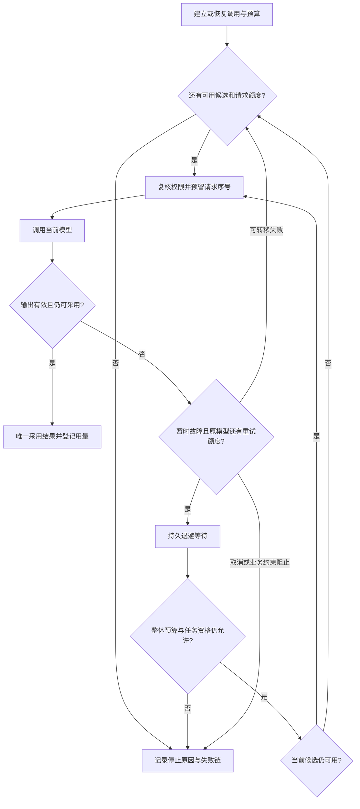

# AI 模型管理详细设计

> AI-Tender 实施核对（2026-10-05）：本文是需求基线，不能用部分实现代替全文验收。已实现能力及未完成项见 [逐项核对表](docs/设计/15-AI模型需求核对.md)，工程映射见 [本仓库模型路由设计](docs/设计/12-LLM管理与模型路由.md#11-四类模型能力与参数补齐2026-10-05)。

2026-10-02 保留规则：AI 调用元数据与用量记录在调用终结且对账完成后默认保留 90 天，操作审计默认 180 天，测试图片等临时资产失效后默认 24 小时，管理员可调整。unknown/未结算预留、晚到用量及有效任务或引用需要的记录受保护，不能从请求发送时直接计时删除。默认不存完整私有提示词/响应正文；账本清理不抹除文稿/任务产物的最小调用来源身份，不改变历史模型名称快照。测试有效期与临时资产清理期是不同配置，完整计时及保护规则见 [设计10 第7节](10-权限配置与运行维护详细设计.md)。

日期：2026-09-30。状态：用户确认的设计基线；已补齐可点击 HTML 管理原型，应用、数据库迁移和真实管理 API 尚未实现。管理归属 M11，模型执行归属 M04，知识库与检索归属 M07/M08；任务、并发、暂停、取消和恢复继续使用 M09。通则见 [设计02](02-数据与接口通用规范.md)，字段级契约见 [AI 管理接口](api/ai.md)，UI 双向核对见 [设计12](12-全模块UI与需求一致性设计.md)。

## 1. 范围与已确认决定

首期交付供应商、模型、功能绑定、排序、同模型重试、跨模型故障转移、密钥加密、按能力测试、平台共享授权、调用记录和管理页。支持文本、视觉、向量、重排及生图模型；生图本期提供管理、测试和记录，PPT 中的手动生图、预览插入及自动配图另列后续任务。导出仍完全不调用模型。

供应商和模型按工作区隔离，平台模型可逐模型授权给指定工作区。首期适配 OpenAI、Anthropic、Gemini 原生协议，保留 OpenAI 兼容网关和经允许的本机/内网服务，并增加专用重排适配器。协议与能力分别登记，不能假定同一供应商支持所有模型种类。

2026-10-04 用户确认模型自行控制：平台按管理页/API配置调用，不按本地/云端部署、供应商品牌或数据区域额外筛选，也不要求选用平台推荐模型。仅知识库限定证据来源，不禁止使用用户配置的外部推理模型。随后确认的端点安全规则仍保留HTTPS/明确授权内网HTTP、凭证保护、SSRF和重定向防护；这些规则不构成模型部署方式或区域白名单。未实现的协议/能力如实提示不支持，不以模型名称伪造适配成功。功能排序、共享授权、向量空间、次数/时间/可选金额预算仍按既有规则执行。

模型与供应商参数全部通过管理页/API 配置，不从 `.env` 导入，也没有空注册表或缺少密钥时的 `LLM_*` 运行回退。数据库不可用时停止新调用。部署环境仍提供主加密密钥、数据库连接及网络策略；这些不是模型注册来源。

| 控制项 | 已确认语义 |
|---|---|
| `extraRetries` | 每个模型失败后的额外重试次数，整数 0—10，默认 1；首次请求另算一次 |
| `failoverLimit` | 每个功能最多实际尝试的不同可用候选模型数，整数 1—10，默认 3 |
| `maxTotalRequests` | 一次逻辑功能调用的模型请求总上限，整数 1—20，默认 6；含首次请求、同模型重试和换模型请求 |
| 其他预算 | 同时受逻辑调用截止时间、任务剩余预算和供应商请求准入约束；哪个先到就停止 |
| 绑定数量 | 每功能 0—10 个；非空时优先级严格为 1..N，不允许重复或空洞 |
| 请求超时 | 模型默认 90 秒，可配置 1—600 秒；实际超时不超过调用剩余时间 |

`failoverLimit=3` 不是“额外换三次”；`extraRetries=1` 不是总共一次。默认持续发生暂时故障时顺序为 A 首次、A 重试、B 首次、B 重试、C 首次、C 重试。若 A 配额外重试 10 次而总请求上限为 6，A 最多发 6 次，随后直接停止，B/C 不再获得请求机会。页面明确展示这一关系，不承诺所有候选都能被尝试。

一次逻辑调用是一个业务步骤内的一次模型执行，由 `invocationId` 标识。重试和切换只递增请求序号，不新增任务尝试、计划版本或页面身份。业务质量修复使用新的调用身份并关联原调用，仍累计同一任务的时间、次数与费用预算，不能借修复循环绕开限制。

## 2. 模型种类、协议与功能

`kind` 区分 `language`、`embedding`、`rerank`、`image_generation`。视觉由 `image_input` 等能力标记表达，同一个语言模型可以同时接受文本和图片。`capabilities` 是经过管理员确认的允许能力；测试结果单独记录，不能只凭模型名称或远端目录推断视觉、工具调用或结构化输出支持。

UI 类型名称使用 **Embedding · 嵌入** 与 **Rerank · 重排**。Embedding 下区分纯文本（`text_input + embedding`）和多模态（额外 `image_input`，首期文本＋图片）；只读 `embeddingInputType=text/multimodal` 从能力派生，非嵌入模型为空。模型表单、导入、列表筛选和测试均显式区分；这不是新增 language 种类或把语言模型视觉能力当作向量能力。音频/视频不因“多模态”名称自动加入。实际支持范围来自已实现适配器与管理员声明，不对所有同协议供应商作能力承诺。

`GET /ai/settings` 返回 `adapterProfiles`（已实现协议/模式/种类、允许能力、参数边界），模型返回 `supportedParameters`。页面据此展示适用参数，不能根据名称猜测 temperature/maxTokens 或图片嵌入支持。模型级规则可以比组合规则更窄；服务端仍独立校验，前端不上传任意适配脚本。

| 协议键 | 首期适配责任 | 边界 |
|---|---|---|
| `openai` | 原生文本/视觉、向量、生图等已登记能力 | 语言模型显式选择 Responses 或 Chat Completions 模式；不按模型名猜接口 |
| `openai_compatible` | 符合已实现请求/响应契约的云网关、本地服务 | “兼容”不代表全部参数、流式用量、取消或目录接口可用 |
| `anthropic` | 原生 Messages 的文本/视觉与相应工具/流式输出 | 不把语言模型成功当作 embedding、rerank 或生图可用 |
| `gemini` | 原生文本/视觉、向量及生图能力适配 | 请求参数、能力与 API 版本由实际适配器清单确定 |
| `rerank_http` | 独立重排请求与结果校验 | 首期固定契约，禁止管理员上传任意请求脚本 |

`apiMode` 使用受控枚举 `responses`、`chat_completions`、`messages`、`generate_content`、`embeddings`、`rerank`、`image_generation`。这是适配器操作类别，不保证不同协议使用同一个 HTTP 路径。协议、模式、模型种类、能力、参数须交叉校验；不支持的组合返回明确错误。

专用重排适配器的首期契约为向已登记 API 根地址的 `/rerank` 提交 `model`、`query`、`documents`、`top_n`，接收 `results[{index,relevance_score}]`；例如 API 根地址含 `/v1` 时形成 `/v1/rerank`。服务端按原候选位置恢复来源身份，校验索引范围、去重、有限数值和返回数量。此处是本项目支持的具体兼容契约，不宣称所有重排供应商天然兼容；不匹配者新增有版本的适配器，不将聊天模型评分冒充专用重排。

| 功能键 | 名称 | 模型要求及产品边界 |
|---|---|---|
| `conversation` | 对话理解 | language；文本理解与受限意图 |
| `outline` | 大纲规划 | language；规划结果通过业务 schema |
| `slide_generation` | 页面生成 | language；只产出内容/提案，文稿应用另行幂等执行 |
| `slide_edit` | 局部编辑 | language；对象范围、手动修改和保护规则继续有效 |
| `content_review` | 内容检查 | language；用户主动触发的独立内容检查，不绑定导出 |
| `document_understanding` | 资料/模板理解 | language；实际含图像输入时额外要求 image_input，不静默丢图 |
| `embedding` | 知识库向量化 | embedding；执行时必须匹配索引固定的向量空间 |
| `rerank` | 检索重排 | rerank；权限过滤后的候选排序 |
| `image_generation` | 图片生成 | image_generation；本期管理、绑定、测试可用，创作入口后续增加 |

功能由服务端登记，首期不开放任意新增功能或 `retry` 功能。管理员为每个功能提交整张绑定表；创作端按功能自动选择，首期不增加每次对话任意覆盖供应商/密钥的入口。

## 3. 工作区、共享与网络权限

工作区管理员管理自己的供应商、模型、绑定和调用记录；平台管理员管理平台供应商及逐模型共享授权。工作区只能读取、绑定和使用已授权的共享模型，不能改平台模型参数、重试次数或密钥，也不能查看其他工作区调用记录。共享模型视图不返回平台供应商地址、密文或密钥提示。

授权记录按 `(model_id, workspace_id)` 管理。撤销共享后保留绑定行及原优先级，并显示“授权已撤销”，停止未发出的调用；不静默解绑或借全局配置绕过。重新授权仍需检查模型、供应商及网络策略。用户正文访问与平台运行元数据权限分开，平台模型所有者不因此获得所有文稿正文。

所有出站动作，包括远端目录、连通测试、重试和故障转移，均复核工作区、共享授权、来源外发策略与供应商网络范围。供应商地址是受控 API 根地址，协议适配器附加固定路径。公网默认 HTTPS；本机/内网 HTTP 仅在部署管理员允许的目标范围内使用，工作区表单不能扩大该范围。

地址拒绝内嵌账号密码、密钥查询参数、片段及未支持协议；服务端校验 DNS 解析、IPv4/IPv6、连接目标和重定向。默认不跟随供应商重定向，不向不同源转发凭证；本地许可不自动包含元数据服务等敏感目标。凭证采用适配器规定的请求头，浏览器不直接连接供应商。

## 4. 数据模型与历史

下表使用逻辑 SQL 名称，HTTP 字段使用 camelCase。迁移编号按本项目正式工程的实际顺序分配，不预占其他项目的 `0003`。租户归属、UTC 时间、版本、错误和事务遵循设计02。

| 表/表族 | 核心字段 | 约束 |
|---|---|---|
| `ai_providers` | id、scope、workspace_id、name、protocol、base_url、auth_mode、api_key_ciphertext、api_key_hint、api_key_updated_at、credential_revision、enabled、last_test_status/at/error/revision、revision、deleted_at、created_at/updated_at | workspace 范围必须有工作区，platform 范围不得伪装成任意工作区；各作用域内未删除名称唯一；protocol 创建后不可修改 |
| `ai_models` | id、provider_id、model_key、display_name、kind、api_mode、capabilities、timeout_seconds、temperature、max_tokens、extra_retries、parameters、embedding_space_id、enabled、last_test_*、revision、deleted_at、时间戳 | 同一供应商下未删除 model_key 唯一；model_key 创建后不可修改；extra_retries 0—10，默认 1 |
| `ai_features` | workspace_id、key、name、description、failover_limit、max_total_requests、revision、时间戳 | `(workspace_id,key)` 唯一；创建工作区时幂等登记九类功能；两个上限分别为 1—10、1—20 |
| `ai_feature_models` | workspace_id、feature_key、model_id、priority | `(workspace_id,feature_key,model_id)` 与 `(workspace_id,feature_key,priority)` 唯一；priority 1—10；提交时额外验证连续性 |
| `ai_model_grants` | id、model_id、workspace_id、revision、revoked_at、created_by、时间戳 | 仅平台模型允许共享；每模型/目标工作区最多一个有效授权 |
| `ai_invocations` | id、workspace_id、feature_key、purpose、task_id、task_attempt_id、step_id、deck_id、page_id、parent_invocation_id、配置快照、截止时间、候选/请求计数、状态、停止原因、selected_model_id/name、时间戳 | 保存候选顺序、重试及预算快照和跳过原因；结果与任务控制代次绑定；管理测试的业务关联可空 |
| `provider_requests`（扩展） | id、invocation_id、provider_id、model_id、供应商/模型名称及 model_key 快照、协议/适配器/凭证版本、candidate_ordinal、retry_ordinal、request_ordinal、provider_request_id、status、result_disposition、http_status、latency_ms、错误摘要、时间戳 | 本表继续作为实际调用账本，不再建平行的 llm_call_log；`(invocation_id,request_ordinal)` 唯一；首次 retry_ordinal 为 0 |
| `usage_records`（扩展） | provider_request_id、prompt_tokens、completion_tokens、image_count、vector_count、document_count、费用/币种、是否估算、来源 | 不适用或供应商未返回的用量为 null，不伪装为零；晚到用量可补录；费用不是仅凭 tokens 推断的最终账单 |
| `ai_tests` | id、scope/workspace_id、provider_id、model_id、capability、被测配置/凭证版本、status、call_log_id、错误摘要、临时测试资产、时间戳 | 持久测试操作；目录测试允许 model_id 为空；旧测试不能覆盖新配置的测试状态 |
| 索引代次（扩展） | embedding_model_id、embedding_model_name、embedding_space_id、dimensions、模型/预处理版本 | 运行中的索引固定模型和空间；同维度不等于同一空间 |

调用日志是 `provider_requests + usage_records` 的授权查询视图。请求另存发送时的授权/共享/来源策略/任务控制版本、费用预留身份及计价版本，用于恢复与结果资格比较。任务/步骤及页面产物保存所采用的 `invocationId`、模型 ID 和名称快照，单页多次调用不压成文稿级唯一模型。供应商/模型改名不会改历史；删除模型不级联删除账本、产物或索引历史。有效索引保留引用，不能靠删除外键消除影响。

供应商和模型软删除。模型仍被功能绑定、有效索引固定或有效共享授权引用时拒绝删除，返回权限范围内的阻止原因和解绑/迁移入口。供应商删除原子检查所有子模型；无这些引用时可一并软删除子模型。仅禁用允许保留绑定，并在下一次出站检查中跳过。名称和 model_key 的唯一约束只覆盖未删除记录，重新创建获得新身份，历史不合并。

索引建议：供应商/模型按 scope/workspace 与更新时间分页；绑定按工作区/功能/priority；授权按目标工作区/有效状态；调用按 `(workspace_id,created_at DESC,id DESC)` 并配合 feature/model/status 索引；invocation 内按 request_ordinal 查询。共享关联在事务中检查授权，不能用“两个 ID 都存在”替代作用域校验。

## 5. 优先级提交与配置生效

功能详情 GET 返回整个聚合及 ETag；修改上限和替换绑定共用此聚合版本。绑定通过 PUT 整表提交，写请求携带 If-Match 和 Idempotency-Key。服务端校验归属/授权、种类、模型不重复、数量不超过 10、priority 唯一且等于 1..N，然后在同一事务锁定聚合、替换绑定、递增 revision、登记审计和 outbox。失败完全回滚；旧版本返回 412，不覆盖其他管理员的修改。

既有绑定在撤权后可以原身份保留、移动或移除，不能因此阻止用户调整其他模型。保留失效引用只承认当前聚合中已经存在的 modelId，不允许新增未授权模型或通过替换身份引入它；失效行显示绑定时保存的名称快照，不读取撤权后的新私有元数据。运行时仍跳过该行。前端保存前明确显示保留了哪些不可用项。

前端“设为 N 级”的算法是：已有模型先从草稿数组移除；新模型先检查 10 个上限；把目标位置夹到剩余数量的 `1..数量+1`，插入后重新编号 1..N。移动、解绑和拖拽都采用此算法；第 11 个直接提示上限，不挤掉末位。服务端仍独立检查整表，不替非法输入自动修复。

绑定、模型/供应商删除、共享撤销和索引固定使用统一资源锁顺序及提交前复核，避免“检查无绑定后被并发绑定”。实现顺序固定为涉及的供应商、模型、授权/索引引用、功能聚合，组内按稳定 ID 排序；事务中不发供应商请求。

每个新 invocation 固定候选顺序、模型参数和重试/总量策略，配置变更不增加在途调用的预算。每次真正发送前重新检查启用、授权和外发策略，并读取同一完整版本的供应商地址与凭证；不得把旧地址与新密钥混用。密钥轮换影响尚未发出的请求，实际使用版本逐请求记录。普通改名不改历史快照；安全收紧对在途结果的采用仍有效。

空绑定返回 `AI_FEATURE_UNCONFIGURED`。有绑定但全部禁用、撤权、不兼容或缺密钥时返回 `AI_NO_AVAILABLE_MODEL` 并保存可见原因；不会回退环境模型。平台模型的参数由平台所有者维护，工作区只设置自己的排序和功能上限。

## 6. 同模型重试与故障转移

### 6.1 请求分类

| 结果 | 同模型重试 | 后续候选/业务处理 |
|---|---|---|
| 连接失败、超时、429、适配器认定可恢复的 5xx | 在 extraRetries 和总预算内退避重试 | 本模型次数耗尽后切下一个可用候选 |
| 供应商 401/403、失效模型地址、不可恢复 4xx/5xx | 不重试原模型 | 当前配置不再可用，进入后续候选判断；认证失败可跳过同凭证版本的其他候选 |
| 返回 JSON 无法解析、输出 schema/结构失败 | 不重试原模型 | 在预算内尝试下一候选；不得把非法结构直接应用到文稿 |
| 本地输入/schema 错误、用户取消、权限/来源策略失效、对象版本冲突 | 不重试 | 停止或交业务冲突处理，不通过换供应商绕过 |
| 模型明确拒绝请求或内容约束阻止执行 | 不重试 | 返回可解释结果，不把拒绝当故障转移理由 |
| 已通过结构校验，但低置信度、来源不足或内容质量欠佳 | 不当作连接失败重试 | 交现有质量/来源流程，必要时受限修复或等待用户决定 |

参数不兼容应在适配器发送前报错；若供应商返回模型特定参数错误，不重复发送同样请求，只有下一候选本身支持该合法业务输入时才可继续。401/403 的供应商认证错误与本平台用户权限错误必须区分。

### 6.2 执行算法

1. 建立/恢复 invocation，读取剩余时间、费用/次数预算和有序候选快照。
2. 逐项验证当前模型/供应商/共享授权/能力/向量空间；不可用项记录跳过原因，不计入候选数和模型请求总数。
3. 对首次实际发送的候选增加 candidate_ordinal；同一候选额外重试不增加此计数。若不同候选数已达 failoverLimit，不再开启新候选。
4. 每次发送前核验全部预算与控制代次，申请供应商请求额度，在共享预算事务中预留费用和请求序号并持久记录；`request_ordinal` 覆盖首次、同模型重试与切换，不能因 Worker 重启归零。
5. 在数据库事务外调用适配器。请求成功后校验结构、授权与产物提交资格；由唯一结果选择和后续文稿操作身份确保只采用一次。
6. 对可重试故障，在该模型额外次数未用完且整体预算允许时登记 next_retry_at；否则转下一个候选。所有出口记录停止原因和失败链。

预算边界为 `实际模型请求数 ≤ min(maxTotalRequests, 已尝试候选各自的 1 + extraRetries 之和)`。跳过不是一次网络调用，但一个已请求过的模型即使后来禁用，其历史候选和请求计数也不会退还。更改配置、暂停恢复、队列重投和 SDK 重试不能重置这些计数。

暂时性重试使用指数退避和随机抖动；首期基准 1 秒、上限 30 秒，尊重合法 Retry-After。若供应商要求的等待超过剩余截止时间，不提前重试；可切换其他独立可用候选或结束。等待持久化给 M09 调度，不占用 Worker 睡眠槽；若额度已释放，唤醒时必须重新准入。SDK 自动重试设为 0，重试只由本层统一执行。

费用沿用任务/工作区的共享预算台账：根据带版本的计价资料和本次最大输入/输出/图像参数原子预留，避免并行请求重复消费同一余额。unknown 请求继续保留预留额，晚到用量按请求身份幂等结算，不能因客户端超时立即退款。金额预算已启用但无法形成可信预留估算时停止自动请求并返回 `AI_COST_ESTIMATE_UNAVAILABLE`；未配置金额预算时明确只有次数/时间限制，不宣称费用受限。估算准入不等于供应商最终账单的硬上界，实际金额超过预留时据实登记并阻止余额不足后的新调用。

### 6.3 超时、不确定请求与恢复

用户已接受纯模型计算超时后有界重试/切换可能重复计费。若供应商支持查询/取消，适配器先做有界核对；无法确认时将原请求标记 unknown，仍可在新额度和预算允许时继续。每次模型重试使用独立请求身份，保留与原 invocation 的关联。

unknown 不等于物理请求已停止，不能假称总并发严格受控；后续请求取得新的准入资格，旧占用由 M09 对账。对没有查询能力的端点，采用设计07第4节的“推定结束”：请求超时加端点宽限（默认 15 分钟）后释放物理占用，原因记 `presumed_ended`，费用预留保持未结算；该释放是明确登记的近似，不是停止证明，因而不会让供应商额度被永久占满。没有足够额度时等待或结束，不绕开供应商限额。没有可核对供应商能力时，不宣称精确费用或严格物理取消已实现。

Worker 在“预留请求/发送”之间崩溃，不能确定是否发送的记录按 unknown 处理并占用预算，不能恢复后无记录地再发一次。采用结果必须在事务中比较 invocation 仍非终态、尚未超过截止时间、任务控制/计划/来源策略及发送时的授权代次。共享撤销后重新授予会产生新授权代次，不能让旧授权下发出的结果重新取得资格。结果晚到可补充用量和真实请求状态，但失效代次、终结调用、超时截止或已被其他结果替代的内容标为 discarded，不进入文稿。文稿保存/编辑/导出副作用继续按原操作身份去重，不使用模型重试次数驱动重复写入。

全部候选或预算耗尽时仅失败当前页面/步骤，保留已完成页、素材和人工修改，提供单页/步骤重试入口；其他独立步骤可继续。大纲等必要输入失败时，其依赖步骤不执行。显式业务重试遵循 M09 创建新尝试和重新检查预算；调用内部重试不占该序号。

## 7. 向量空间与检索降级

embedding 功能为新索引选择模型；已有索引及查询绑定其 embedding_space_id、模型版本、维度和预处理版本。全局功能排序改变不会令旧索引立即改用新模型。即使两个模型维度相同，也不能假定向量可以混用。

只有经适配验证确认处于同一向量空间的实例才可作为该索引的备用候选；model_key 相同或管理员随意填写相同标识不足以证明兼容。无法证明时不故障转移到其他空间。更换模型建立完整新索引代次，完成后原子切换，期间保留原索引与模型；失败不会留下半新半旧索引。

兼容证明保存空间契约指纹，绑定供应商端点、模型与上游版本、适配器、维度、归一化和预处理版本。修改这些要素使证明失效，在重新验证之前不能向既有索引写入或用该实例查询；必要时仅走关键词降级。仅密钥轮换、展示改名不改变空间身份。索引使用已固定契约核验每次请求的有效端点版本，不能在地址修改后沿用原空间标识而跳过检查。

向量查询失败可退回仍可用的关键词召回；重排失败可返回原召回排序。检索结果使用 `status=partial`、`degradedStages`、`warnings` 和关联调用身份说明降级，不把质量降级伪装成完整成功。权限过滤、来源版本和证据校验不放宽。所有检索方式都不可用时，停止依赖检索的步骤；成功查询但没有命中是“无证据”，不等同供应商故障。

## 8. 密钥保存、轮换与审计

服务端使用 Node 内置 crypto 的 AES-256-GCM。部署变量 `LLM_SECRET_KEYS` 为逗号分隔的 Base64 编码 32 字节主密钥，第一个用于新加密，其余仅用于解密；它是加密设施配置，不是 LLM_API_KEY 回退。重复/格式错误的主密钥在加载时报告，密钥设施未就绪不影响无密钥的管理查询和允许的匿名本地服务。

密文封装保存格式版本、由主密钥摘要派生的 keyId、每次随机生成的 12 字节 nonce、密文和 16 字节认证标签；AAD 绑定作用域、providerId、credentialRevision，防止不同供应商之间搬用密文。主密钥不进入数据库、前端构建和日志。

API 的 apiKey 为 writeOnly：省略表示保留；`clearApiKey=true` 表示显式清除，与 apiKey 互斥。响应只回密钥状态、后四位提示与更新时间，密钥长度不超过四位时仅显示“已配置”。表单保存后清空输入，编辑时不使用星号占位串作为密钥提交。不存在密钥解密/导出接口。

未配置主密钥时禁止新增/替换密钥，其他元数据管理正常；缺密钥的 api_key 供应商标为不可调用。允许的匿名本地服务可用 authMode=none。密文损坏或旧主密钥缺失返回明确不可用状态，绝不尝试环境 API Key。

轮换顺序：所有 API/Worker 先能读取新旧密钥 → 新密钥置首 → 分批解密并以新密钥重加密 → 核对存量与备份恢复需要 → 再移除旧密钥。重加密使用 credentialRevision/CAS，不覆盖管理员同时换入的密钥；纯重加密不伪造供应商密钥更新时间。移除旧密钥需要覆盖保留备份的恢复方案，不自动清理。

密钥请求体、Authorization 等头、供应商错误中的回显内容均不进入普通日志、审计或幂等响应缓存。密钥字段仅通过服务端带密钥指纹参与幂等请求摘要，不存原文请求体。管理日志记录谁、何时、对哪个配置做了何种变更及版本，不记录凭证值。

## 9. 目录、导入与连通性测试

远端目录由后端通过所选协议适配器访问，OpenAI 风格目录只是其中一种实现。列表仅作为候选，保留分页及来源；管理员勾选并确认种类、模式和能力后导入。一次最多导入 100 项，导入结果区分 created/skipped；已有模型不被覆盖。导入事务不发外部请求，不自动绑定、不自动删除远端消失的本地模型。手动创建与确认配置后导入的模型默认启用；启停开关放在模型列表中，编辑配置不修改启停状态。

供应商测试调用其目录接口。目录不支持时标 unsupported，仍允许手动登记模型并测试；目录 403/失败不自动禁用该供应商的全部模型。普通拉目录与“保存配置”不自动触发推理测试。

| 测试对象 | 最小探测 | 检查内容 |
|---|---|---|
| 供应商 | 适配器的模型目录操作 | 认证、地址和目录协议；不声称所有模型可用 |
| 文本 | 不带工具的短请求，使用该模式接受的最小输出预算 | 传输、返回格式与文本能力；不统一硬编码 max_tokens=1 |
| 视觉 | 内置非私有小图和简短问题 | 确认图片实际输入并得到有效响应 |
| 纯文本 Embedding | 固定短文本，capability=embedding | 向量数量、维度、有限数值及声明空间一致性；不证明图片输入或跨模型语义兼容 |
| 多模态 Embedding | 固定短文本＋内置非私有小图，capability=multimodal_embedding | 验证图片实际作为嵌入输入、向量数量/维度/有限数值；仅声明 image_input 或普通文本/视觉测试不构成通过，探测不证明跨模型联合空间兼容 |
| 重排 | 固定问题和少量固定候选 | 返回索引、分数及排序结构合法 |
| 生图 | 单张、适配器允许的最低成本参数 | 实际得到可读取图像；临时预览与清理，不进入文稿或正式素材库 |

测试是显式动作，页面提示会发送真实请求且可能产生费用。本轮设计验证使用模拟器，不执行真实供应商请求。一次测试只提交一次被测能力请求，不执行同模型自动重试或跨模型切换，避免测试结果被备用模型替代。测试仍受独立测试频率、供应商并发和预算约束；长测试返回 202 及 testId，刷新后可查询。

测试记录状态为 accepted/running/succeeded/failed/unsupported，并标明对应配置版本及是否 stale。回写 last_test_* 时比较被测 revision/credentialRevision 及测试开始顺序，旧测试晚到不能覆盖新配置或更新测试。测试不自动修改 enabled 或功能排序。供应商/模型接口的失败摘要必须脱敏。

Q24 已确认测试结果默认有效7天，管理员可调。记录 completedAt、expiresAt、validityPolicyVersion、配置能力指纹和失效原因；有效期从测试明确终结时按连续7×24小时计算。供应商地址/协议、实际凭证、模型标识/能力或影响测试的关键参数变化立即 stale；改显示名称、重排功能优先级或仅重加密同一凭证不伪造能力变化。当前展示同时计算时间与指纹有效性，不依赖后台扫描及时改标志；expired/config_changed 不自动禁用模型，也不自动调用供应商。

新有效期策略用于新测试，既有 expiresAt 不默默改写；管理员显式调整既有有效期须登记影响。失效不删除测试事实或把曾经 failed 显示为成功；历史详情保留被测版本/状态，当前摘要展示“需重新测试”及原因。测试图片取有效期到达、配置失效、测试放弃等实际失效时刻，再进入24小时清理；仍被有效测试/核对引用时延后，失效状态不能通过重新授权复活旧结果。

共享工作区有 ai.test 权限时可以测试已授权模型，使用该工作区的测试预算并只保存本工作区测试结果；不能据此回写平台模型所有者的 last_test_* 或读取平台目录/凭证。平台模型最近测试由所有者的测试更新。

## 10. 接口与错误

统一前缀 `/api/v1/ai`，使用现有身份、CSRF、工作区头、游标分页、ETag/If-Match 与 Idempotency-Key。平台资源使用独立平台权限；shared 只读模型视图按当前工作区授权过滤。普通用户不能通过 body.scope 提权。

| 接口（相对 `/api/v1`） | 用途 |
|---|---|
| `GET /ai/settings` | 加密设施就绪状态、已实现协议与限值；不回密钥或原始网络配置 |
| `GET /ai/providers`、`POST /ai/providers` | 供应商列表、新建 |
| `GET /ai/providers/{providerId}`、`PATCH /ai/providers/{providerId}`、`DELETE /ai/providers/{providerId}` | 详情/ETag、修改、软删除 |
| `POST /ai/providers/{providerId}/tests` | 供应商目录测试 |
| `GET /ai/providers/{providerId}/remote-models` | 服务端代理目录 |
| `POST /ai/providers/{providerId}/imports` | 勾选导入 |
| `GET /ai/models`、`POST /ai/models` | 自有/获共享模型列表、手动新建 |
| `GET /ai/models/{modelId}`、`PATCH /ai/models/{modelId}`、`DELETE /ai/models/{modelId}` | 详情、修改、软删除 |
| `POST /ai/models/{modelId}/tests`、`GET /ai/tests/{testId}` | 按能力测试、查询结果 |
| `GET /ai/models/{modelId}/grants`、`POST /ai/models/{modelId}/grants` | 平台模型共享授权列表/授予 |
| `GET /ai/model-grants/{grantId}`、`DELETE /ai/model-grants/{grantId}` | 共享详情/ETag、撤销 |
| `GET /ai/features`、`GET /ai/features/{featureKey}` | 功能列表、聚合详情/ETag |
| `PATCH /ai/features/{featureKey}`、`PUT /ai/features/{featureKey}/bindings` | 修改两个上限、原子替换排序 |
| `GET /ai/call-logs`、`GET /ai/call-logs/{callId}` | 游标分页/详情，按 featureKey、modelId、status、时间筛选 |
| `GET /ai/invocations/{invocationId}` | 同模型重试、跨模型切换、跳过原因和最终停止原因 |

原 `/provider-configurations` 保留用于搜索等非模型工具的受控凭证引用，不再配置 AI 模型白名单。AI 供应商使用本节接口，避免出现两条可修改同一模型路由/密钥的入口。

业务错误按设计02 的 ApiError 格式登记；HTTP 管理请求在持久受理前使用相应状态，已受理测试/任务的执行错误保存在其结果中，不把“测试成功受理”误报成“供应商连通”。

| 错误码 | HTTP | 语义/处理 |
|---|---|---|
| `AI_SECRET_KEY_UNAVAILABLE` | 503 | 无可用主密钥，禁止保存/替换密钥；允许其他管理操作 |
| `AI_CREDENTIAL_UNAVAILABLE` | 422 | 密钥缺失或无法解密，修复配置；不回退环境密钥 |
| `AI_ENDPOINT_NOT_ALLOWED` | 422 | 地址不在允许网络范围 |
| `AI_CAPABILITY_UNSUPPORTED` | 422 | 协议、模式、种类、参数或测试能力不匹配 |
| `AI_PRIORITY_INVALID` | 422 | 排序重复、不连续或存在重复模型 |
| `AI_BINDING_LIMIT_EXCEEDED` | 422 | 第 11 个模型/超上限，拒绝整个替换 |
| `AI_RESOURCE_IN_USE` | 409 | 功能、索引或共享仍引用，先解绑/迁移/撤销 |
| `AI_FEATURE_UNCONFIGURED` | 409 | 当前功能无绑定 |
| `AI_NO_AVAILABLE_MODEL` | 503 | 无可调用且获授权的兼容模型 |
| `AI_CATALOG_FAILED` | 502 | 远端目录请求失败，手动登记仍可进行 |
| `AI_PROVIDER_REQUEST_FAILED` | 502 | 供应商请求失败，是否重试由分类与剩余预算决定 |
| `AI_OUTPUT_INVALID` | 502 | JSON/结构不合法，可尝试后续候选，不原模型重试 |
| `AI_REQUEST_OUTCOME_UNKNOWN` | 504 | 请求结果未知；保留占用/费用不确定性 |
| `AI_RETRY_BUDGET_EXHAUSTED` | 409 | 总次数、时间或费用预算耗尽；调整条件后显式重试 |
| `AI_COST_ESTIMATE_UNAVAILABLE` | 409 | 已启用金额预算但无法可信预留费用，补齐计价/预算策略后重试 |
| `AI_ALL_CANDIDATES_FAILED` | 502 | 已尝试候选全部失败，展示局部恢复入口 |
| `AI_EMBEDDING_SPACE_MISMATCH` | 422 | 与索引空间不一致，需兼容候选或新索引 |

通用重复名称/状态冲突使用 STATE_CONFLICT，过期版本使用 REVISION_CONFLICT，缺 If-Match 使用 PRECONDITION_REQUIRED。retryable 表示在当前条件下是否适合再请求，不表示所有 5xx 都应由前端自动重发。未授权资源遵循通用 403/404 防枚举规则。

## 11. 管理页交互

工作区设置新增“AI 管理”，包含供应商、模型、功能绑定、调用记录四个页签；平台管理员可切换平台范围并管理模型共享。访问控制来自服务端，隐藏按钮不能替代权限。[P35 原型](../../prototype/pages/35-ai-management.html)已接入工作区导航，代表性交互与权限视图已实现；正式页面/API 联调继续按 G1-14，范围与核验见 [设计12](12-全模块UI与需求一致性设计.md)。

供应商表单展示协议、API 根地址、启用、密钥状态/尾号/更新时间、最近目录测试。无主密钥时禁用密钥保存并显示部署配置说明，元数据仍可保存。拉取目录后提供勾选和手动录入，说明目录并非能力证明。删除阻止信息直达绑定、索引或共享处理入口。

模型列表可按供应商、种类、启用/可用状态筛选；编辑面板按协议/种类显示参数，不展示无法使用的 temperature/maxTokens。extraRetries 标为“失败后额外重试次数（0—10）”，旁注“1 表示首次请求外再试一次”。测试按能力选择，展示未测试、进行中、通过、失败、不支持和配置已变化；生图预览只属于测试结果。

模型列表额外提供 Embedding 输入类型筛选，纯文本与文本＋图片多模态分别标识。多模态可以独立做纯文本测试和图文嵌入测试，后者默认选中；纯文本模型不提供图文测试。改变输入类型更新 capabilities，并使相关测试/索引兼容证明失效；UI 不提供填写相同空间身份冒充兼容的入口。

自有管理详情通过 `deletionImpact` 返回引用计数与权限范围内的绑定/索引/共享处理入口，共享与只读视图该字段为空；超过100个入口明确截断，可前往对应列表处理。授权详情通过 `revocationImpact` 返回目标工作区受影响绑定/有效索引计数及评估时间；确认撤销前刷新详情。两种影响都是只读快照，删除/撤销事务仍重新检查，不把过期快照当作无引用证明。

功能页展示完整排序、来源工作区/平台、可用性、两个功能上限及保存前后的差异。拖拽或设为 N 级只改本地草稿，整表保存后显示服务端快照；412 保留草稿并提示比较最新版本。第 11 个按钮直接阻止。页面计算每个候选的理论最多请求数及总量截断提示，避免“备用模型一定会被调用”的误解。

上限 PATCH 与绑定 PUT 是独立操作，共用功能聚合 ETag，但不宣称两个请求联合原子提交。页面先保存上限并更新版本，再显式保存排序；上限未保存时禁止排序提交。只修改排序可直接整表保存；两种保存遇到412都保留草稿并比较最新版本。

调用记录显示功能、供应商/模型快照、候选序号、该模型第几次请求、状态、耗时和适用用量；展开查看一条 invocation 的完整失败链与停止原因。unknown 显示“结果未知，费用可能尚未确认”；丢弃晚到结果和请求执行成功分别显示。默认不展示或保存提示词、私有资料和完整响应正文。

平台共享仅选择明确的模型和目标工作区，撤销前展示受影响绑定/索引计数；撤销立即限制新调用，已有历史保留。共享工作区不提供修改平台模型或读取平台凭证入口。

## 12. 内部端口与验收

| 单元/端口 | 职责与不变量 |
|---|---|
| `AiProviderService` / `AiModelService` | 作用域、受控地址、参数、密钥写入和软删除；明文仅短暂存在于服务端调用路径 |
| `ModelRegistry.resolve` | 工作区 + feature + 请求能力 + 索引空间 → 有序候选与配置快照；不读取环境模型 |
| `ReplaceFeatureBindings` | If-Match、完整列表、权限和连续优先级校验；事务替换与审计 |
| `SecretProvider.resolve` | 原子取得当前完整供应商/凭证版本并解密；不返回浏览器可见秘密 |
| `ProviderGateway.invoke` | 单次模型请求、统一错误分类、结构/用量归一化；适配 SDK 关闭内建重试 |
| `ModelInvocationRunner` | 持久计数、退避、候选切换、预算与结果选择；复用 M09 调度/准入/控制 |
| `ProviderAdapter` | listModels / invoke / probe / reconcile；能力和参数清单有版本，未支持能力显式返回 |
| `AiTestService` | 持久测试操作、一次能力请求、版本条件回写和测试资产清理 |
| `AiCallLogQuery` | 从既有请求/用量账本查询脱敏记录及失败链，按工作区过滤后分页 |

| 验收 ID | 必须覆盖的行为 |
|---|---|
| AI01 | 工作区隔离、平台逐模型授权、撤权在下一次请求前生效；无跨工作区日志/密钥泄露 |
| AI02 | 协议/能力不匹配拒绝，原生与兼容适配分开；专用重排结果严格校验 |
| AI03 | 密钥加密、缺主密钥、只写不回显、尾号、清除、解密失败和多主密钥轮换 |
| AI04 | 管理请求/审计/幂等记录/错误摘要/前端包均不含密钥；地址与凭证版本不混用 |
| AI05 | 远端目录分页、目录不支持仍可手动模型、勾选导入幂等且不覆盖/自动同步 |
| AI06 | 排序移动/插入/解绑无空洞，第 11 个拒绝；重复模型/优先级拒绝；并发替换 412 |
| AI07 | extraRetries 的 0、1、10 合法，11/负数/小数拒绝；0 表示只有首次请求 |
| AI08 | 默认 A/A/B/B/C/C 最多 6 次；A 额外重试 10、总上限 6 时 B/C 不执行 |
| AI09 | failoverLimit 计算不同已请求候选；禁用、撤权、能力不符不耗次数；无可用模型明确失败 |
| AI10 | 超时/429/可恢复 5xx 才在同模型退避；认证/参数/JSON 错误不原地重复；本地权限错误不换源 |
| AI11 | Retry-After、总时间/费用/请求上限、并行费用预留、未知费用保留、暂停取消及调度重投共同受控，SDK 不叠加重试 |
| AI12 | Worker 在发送前后崩溃、unknown、截止/终态及撤权再授权后的晚到结果、唯一采用、计费补录及旧占用对账 |
| AI13 | 局部失败不丢已完成页/手调，独立页继续，依赖步骤停止，内部重试不新增业务尝试 |
| AI14 | 索引固定模型/空间，地址/模型参数变化使兼容证明失效；兼容实例可切换；重建失败保留旧索引 |
| AI15 | 向量/重排降级明确 partial，权限和来源不放宽；无命中与服务故障区分 |
| AI16 | 文本、视觉、纯文本 Embedding、多模态 Embedding、Rerank、生图分别测试；多模态实际输入图文，纯文本测试不证明图片嵌入；不自动重试/切模型；旧测试不覆盖新结果 |
| AI17 | 测试真实费用提示、刷新恢复、默认7天/配置失效及管理员策略；过期不自动禁用或收费重测；临时生图失效后24小时清理，保护有效引用；不自动插图或启动创作 |
| AI18 | 被功能、有效索引、共享引用的模型/供应商拒绝删除；软删除及改名不改历史 |
| AI19 | 所有 AI 配置来自注册表；空库、空绑定、缺密钥、数据库失败都不走 .env 回退 |
| AI20 | 分页/过滤与调用链、未知用量不填零、生图/向量/重排用量可表达；权限先过滤再分页 |
| AI21 | 本地/内网许可、DNS/重定向边界、无授权目标、元数据地址和跨源凭证保护 |
| AI22 | 业务质量修复仍累计任务预算；导出与确定性文稿写入不被模型重试触发 |

这些用例可先用本地模拟适配器和故障注入核验；协议参数、真实取消、流式用量和真实供应商可用性必须在有连接方式与凭证后另行验收。静态设计或模拟测试不标为实际连通成功，不验证尚未提供的真实 MinerU/PDF 坐标。具体重试预算、权限和产品行为已确认；适配器版本及供应商实测仍是实施门槛。

## 本轮全模块列表与一致性补充

分页/卡片列表/搜索交集/选择生命周期、知识库直接及批量操作、队列与定时首版规则、保存屏障与附件解析索引分离，统一见[设计12](12-全模块UI与需求一致性设计.md)。本模块沿用其UI-01—08及相应需求，不再以默认全部卡片或定时策略未定作为设计基线；已补字段与接口以[API附件](api/README.md)为准。离线状态不替代真实服务和引擎验收。

## 13. 测试证明、动态调用策略与unknown人工对账

### 13.1 有效性与配置指纹

`AiTest`/`AiTestSummary`补`AiTestValidity`：configFingerprint、adapterVersion、policyRevision、validForSeconds、state、validFrom/expiresAt/invalidatedAt及reasons。status仍是历史执行事实；`state=pending/valid/expired/invalidated/not_proven`是当前证明。stale保留为兼容布尔，仅配置/安全失效时true，时间过期由validity显式表达。失败/unsupported不成为成功证明；晚到旧测试不可覆盖当前版本的最新结果。

配置指纹采用设计02固定JCS/SHA256，输入只含有效protocol/apiMode、规范化baseUrl、providerId/modelId/modelKey、参数、capabilities、embeddingSpace/preprocess版本、credentialRevision、adapterVersion、网络策略安全revision；绝不含明文/密文密钥或用户私有输入。displayName/排序/extraRetries等不影响本次能力协议的元数据不触发无谓失效；address/凭证/模式/实质参数/能力/空间/适配/网络安全变化立即失效，撤权后按当前授权失效，再授权不恢复旧安全结果资格。目录证明只证明目录，不证明各模型能力；文本测试不证明图文嵌入。

`GET/PATCH /ai/test-policy`提供`AiTestPolicy`，初始validForSeconds=604800（7天），管理员可调1..31536000秒、平台权限/CSRF/幂等/If-Match/审计。有效性查询以当前策略重新计算`expiresAt=successfulFinishedAt+validForSeconds`，policyRevision明示；改变有效期不改历史status，不自动发起收费重测或禁用模型。安全失效不能因延长期限变成有效。临时图片在测试失效时间登记invalidatedAt，24小时清理沿保留策略和有效引用保护，与7天证据期分开。

### 13.2 动态执行数值和请求计数

`GET/PATCH /ai/execution-policy`持久`AiExecutionPolicy`，默认请求超时90秒（1..600）；新invocation总截止600秒（1..86400）并夹到Agent剩余任务预算；retryBaseMs=1000/retryMaxMs=30000，范围100..60000/100..3600000且max≥base；unknown查询间隔30秒（1..3600）、最多3次（0..1000）、每次查询超时10秒（1..600）。平台管理员可热调；模型明确设置的已有timeout不被“默认”隐式覆盖。新的逻辑调用固定配置revision，进行中deadlineAt/最大次数/费用预留不被扩展，暂停/恢复也不清零。

重试`delay=uniform(0,min(maxMs,baseMs*2^retryOrdinal))`，合法Retry-After作为下界；HTTP日期以响应Date/服务端时间有界解析，过去/非法值不使用。剩余时间不足则不提前再发，同模型终止或按既有规则选独立候选。nextRetryAt/计数/使用策略revision持久，M09重新准入，不睡眠占槽。查询供应商状态也是实际网络动作，受相应工具请求准入与时间限速，但不算第二次生成请求；查询超时本身保留查询请求的真实不确定占用，不能忽略它无限查原unknown。

原生适配继续按已登记OpenAI Responses/Chat Completions、Anthropic Messages、Gemini generate_content/embedding及专用rerank协议；以项目`ProviderAdapter`受控HTTP实现或固定SDK封装，关闭SDK内建重试，协议合同与金样响应冻结为adapterVersion，不能按品牌名称猜默认模式。没有凭证先用本地协议金样/错误/流式中断验证；上线前再验证用户实际配置的供应商。客户自行配置端点和模型，不强迫某种本地/云或区域部署。

### 13.3 人工对账权限、证据与回执

不能由业务终态、费用不明或“用户愿承担费用”推导物理请求结束；物理占用的释放只有三条路径：供应商查询确认、人工对账证据，或设计07定义的、带宽限期且显式记录为`presumed_ended`的推定结束。推定结束不改变`billingState`，费用预留仍由对账结算。`AiCallLog`补revision、physicalState=not_started/active/unknown/ended、billingState=not_applicable/unsettled/settled及lastReconciliationId/reconciliationUrl。GET调用链继续呈现业务采用与请求执行成功两个事实；unknown及尚未结算预留受清理保护。

增加`GET/POST /ai/call-logs/{callId}/reconciliations`与单回执GET。写入要求资源当前归属、CSRF、Idempotency-Key、commandId、If-Match及专门`ai.requests.reconcile`（工作区管理员的受控权限）或`platform.ai.requests.reconcile`。平台权限仅允许平台请求，不能借平台模型所有权读取其他工作区正文；跨工作区核对通过请求所属工作区授权或既有运维元数据权限，仍不暴露正文。普通任务所有者只能看脱敏状态和联系管理员，不直接退还请求额度。

输入physicalConclusion=still_unknown/ended、outcome=unknown/succeeded/failed/not_sent、evidenceKind=provider_query/provider_console/provider_support/local_server_log、已登记私有证据assetId、observedAt、脱敏summary及可选usage。证据必须关联该请求身份/调用时间/端点版本，验证上传隔离状态、同作用域/许可和只读引用；证据不存API密钥、私有提示词或完整用户响应。无法按身份对应的总账/主观说明不足以证明物理结束。`still_unknown`只能outcome=unknown且不提供结算usage；请求未发送的结论需要本地发送门禁日志证明。ended可以outcome=unknown（只确认工作停止、内容/费用未查明），物理额度可释放但费用预留仍保留。

短事务统一锁预算/资源claim→任务控制（有关联时）→provider_request，比较请求revision及未决状态，建立不可变`AiRequestReconciliation`、应用物理/计费事实、幂等释放相应claim、审计/outbox。证据不足返回rejected持久回执；冲突/权限/格式失败不创建虚构已应用回执。相同command重复200，首次持久创建201；晚到供应商事实只补录真实请求/费用并保留既有人工证据，冲突标记需复核，不再释放一次，不把旧结果重新选为文稿内容。POST受理并不声称供应商原生取消已生效。

释放物理占用必须有结束证据；退还/结算费用独立使用AiUsage的真实金额/币种/是否估计及来源。不知道费用保留unsettled，不填0；已知最终账单按requestId幂等settle，超预留据实登记并阻止余额不足的新调用。已使用估算不能标作供应商最终结算。核对不重复生成、不更改invocation已选择结果、不复活取消任务/写入资格；它只能恢复可证实的剩余额度。

### 13.4 持久化、加密与验收落实

`ai_tests`增加configFingerprint/adapterVersion/successfulFinishedAt/invalidatedAt/reasons/testPolicyRevision；成功通过按provider/model/capability+版本指纹查询，provider/model/config安全变更和失效审计同事务。`ai_test_policy`、`ai_execution_policy`是带revision/changedBy/updatedAt的singleton配置，值CHECK与跨字段运行时检查同时使用。`provider_requests`增加revision/physicalState/billingState/自动核对计数/nextReconcileAt/lastReconciliationId；未知请求到期索引、callId+commandId及reconciliationId唯一。`request_reconciliation`保存不可变actor/evidence/observation/结果/claim释放和计费状态，证据按有效账本引用保护。

现有主密钥轮换实现AES-256-GCM信封`algorithm/keyId/nonce/ciphertext/tag`，AAD固定providerId+scope+workspaceId+credentialRevision；12byte随机nonce，密钥32byte，版本不同不得混用。轮换生成新keyId后新写用新钥，旧行有界重加密，成功后事务换ciphertext/keyId并审计；解密验证不通过拒绝调用，不回退`.env`模型密钥。旧keyId仍被在线行/受保留备份引用时不得销毁；密钥环从部署受控秘密文件提供，仅后端读取，迁移错误不回显。明文供应商凭证仅在调用路径短暂使用，测试/审计/幂等正文均不保存。

AI16/17固定正负样例：默认7天边界前/到点；管理员缩短/延长；仅改显示名不失效；凭证/端点/模式/空间/网络策略立即失效；旧测试晚回不能覆盖；纯文本测试不能证明多模态；自动重测未发生；测试图失效+24小时及引用保护。AI11/12新增unknown自动查3次耗尽、没有查询能力、人工证据不足、确认结束但费用未知、终态残留占用、回执响应丢失/重复释放、晚到与人工核对竞争；AI03补主密钥不同keyId/AAD错配、轮换崩溃及旧备份仍需旧key。都可先用可控本地适配器，真实费用/取消/用量必须按真实连接另验，不伪造实测。

模块落点为`backend/src/modules/ai/{domain,application,ports}/`中的`TestValidityEvaluator`、`AiPolicyService`、`ReconcileProviderRequest`及`SecretRotationService`；HTTP适配器在`backend/src/integrations/ai/`，账本/密钥仓储在`persistence/`与受控秘密端口。共享M09调度/资格/M05受控提交，不另建任务或调用日志系统。
