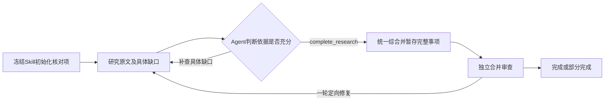

# 解析 Skill 与运行护栏

更新日期：2026-11-08。专题解析执行协议为 `research-v2`，报告冻结 `__analysis_output_mode__ = "after-research"`；业务数据和展示格式版本仍为 `1`。

## 职责与流程

每专题一个主 Agent。程序初始化核对清单，Agent 边检索边理解，按需记录线索，判断依据充分后统一综合，独立审查通过后由程序发布有效成果。



Agent 判断查询关键词、相关性、条款含义、适用范围、修订关系和完整性。代码管理稳定身份、真实检索、授权、分页、缓存、引文真实性、预算、审查映射和发布。命中数量、查询次数、时间和相似度均不能证明内容完整。

## 唯一研究账与轻量工具

`topic_flow` 的工作与证据关联是研究账，`topic_flow.audit` 是审查账；页面进度、覆盖及缺口由它们派生，不要求模型重复登记行政状态。状态和展示投影经既有仓储同事务保存。

`coverage.json` 初始化核对项，程序生成并持久化 `w1/w2/...`。未知范围确认或明确替代后沿用工作身份；改名、换词不增加研究额度。待办使用服务端 ID；已有待办通过工作 ID 更新。模型看到的工作索引按主题和范围分组合并，待办持久ID保留在程序账本；研究回执只返回变化的工作项。

检索填写work短ID后，程序从工作账推导topic_keys；一次检索可用多个工作ID关联多个主题，仍各自累计真实调用和无进展额度。主题探索可单独指定topic_keys，未知工作或错误主题不能绕过门禁。原文块只向主Agent提供id和text，资料目录单独给出文件身份；来源版本、页码、坐标和检索分数留在程序证据账，最终按真实ID补齐定位。分页、截断、预算及当前上下文已有原文提示保留，用于判断是否仍有必要补读。

研究阶段暴露检索、原文补读、按需使用的 `update_research`、只读 `get_research_context` 和阶段出口 `complete_research(research_summary)`，综合阶段才加载业务提交工具和完整输出格式。Agent 判断已理解正文、条件、例外及适用范围后，简述研究结论即可切换到综合；无需先逐项登记found、逐块填写examined或补写范围确认笔记。`update_research` 使用专用 `ResearchDelta`：work_ids、简短detail、状态、证据、语义scope和具体followups；不暴露通用 `TopicUpdate`，不提前生成完整业务正文。

- `found` 表示该核对项已充分研究，须有当前项目原文；`examined` 仅表示已分析所列原文。
- `not_found` 说明检索范围和原因；程序核对真实查询、项目资料覆盖及未读分页／截断，不要求固定查询次数。
- `not_applicable` 须有项目依据；`missing_source` 与 `blocked` 保留明确原因，与未找到分别保存。
- `reopen` 明确重新打开具体工作。已有完成项受阻或重开后，旧发现和有效审查资格撤销。
- 范围确认用 `scope`；补遗替代既有范围用 `replaces_scopes`。新增并存标段不替代旧范围，新范围逐项重新确认。

一份原文只保存一次，可以关联多个核对项。新增证据先登记归属并标为待分析，再由 Agent 判断含义；同主题影响不明时保守撤销关联成果的审查资格，其他主题保留。研究笔记按需保存，不要求逐证据登记。进入综合保留核对清单、待分析原文、待办、转引和真实检索账，不用主Agent的研究结论自动勾选完成；它们随最终正文一起接受独立审查。初始未知范围可直接由提交事项的语义scope确认，已明确范围的变更仍须显式说明。

首次综合的 `synthesis_work_origins` 保留初始未知范围的工作映射，后续批次可沿用原始ID继续拆分并存标段；每条暂存事项绑定其实际范围的当前工作ID。映射随检查点保存，首批不能收窄后续批次的范围；显式重新研究或进入独立审查时撤销该映射，已确认范围仍须按研究协议变更。

工作身份、调用预算及已耗尽状态不会因改名、换词或笔记改写而重置。轻量流程的采集限制按“连续没有新增原文”计算，不用未写研究笔记推断内容没有推进；真实分页和清单续段继续受保护。重复采集关闭只停止继续读取，不自动断言缺少内容；Agent仍可综合已有依据，实际未核清的内容由Agent和独立审查保留具体缺口。正常工作关闭不占参数纠错次数。

## 上下文与综合

通用协议仅在 `protocol.py` 维护，Skill 保留领域判断、核对要求、条件、例外和必要示例。研究阶段每轮提供常驻规则及当前工作的细则：资源行尾用 `<!-- topics: budget,dates -->` 明确关联 `coverage.json` 的主题，由代码选取，不增加模型挑规则的回合。未分类规则、工作方法及未知业务小节持续提供；首次尚未确定工作时使用全集，待分析补遗涉及的主题及上下文中显式依赖的主题一并加入。综合与独立审查使用完整领域规则，综合另加事项组织与冻结格式。部分细则不冒充整文件已加载，完整文件仍可按需读取。自定义清单无法识别关联时完整保留该规则。

`context.py` 按工作、适用范围及显式依赖组织读取内容。研究账累计短笔记与证据关联，待办继承产生它的研究线索；暂存成果保留各自work_ids。读取所选工作的笔记与原文，同时带入共同适用及重叠标段条件、尚未归档／待分析原文、转引、父子与关系端点；同一原文只返回一次。其它工作的正文不因同属一个主题被全部展开。

`get_research_context(work_ids, offset, limit, revision)` 返回完整 `units`。游标按稳定片段序号计算，续页沿用revision及next_offset；修改limit不会跳过内容，笔记、来源版本、原文或成果变化时拒绝旧游标并提示从0重读。长笔记和原文分片保留start／total，has_more=true仍有未读内容。极小limit至少返回一个完整片段，不能切断引文或JSON。

原文去重只认当前有效工具消息中的同版本完整原文，多片段须连续覆盖全文。满足时返回in_context索引；摘要移除、只读过部分或版本变化时提供原文。底层already_read只表示历史读过，当前缺少原文时自动补回；同ID重放也重新判断展示资格。完整工具响应留在缓存，程序版本证明留在消息元数据，实际模型请求和预算计量均剔除该内部证明。

进入综合后隐藏检索；发现具体缺口须先 `reopen` 再研究。`submit_analysis(records, final)` 的每条记录携带自己的 work_ids、业务正文、条件、材料、评分、范围、关系和原文引文，避免不同范围的同批事项交叉关联。程序生成记录UUID、覆盖投影、证据位置、展示文本和排序。模型提交不再包含重复正文text与排序sort_order；首次提交顺序确定位置，修改既有key保留原位置。structuring仍表示业务条件的结构化完整性，继续由Agent声明并接受审查。

按输出容量分批暂存，取消每批三条限制。暂存只做结构、引用和归属预校验，不调用支持性模型。最后一批 final=true 自动进入审查；后续非final或无效提交撤销旧完成意图。未变事项沿用key及稳定身份，修复只修改受影响内容。

综合阶段通过预校验的新草稿及业务内容修改计入阶段进展，避免多批输出被误判为停滞；重复断言、重命名、重复暂存和待复核标记切换不延长无进展额度。草稿仍须完成独立审查才能发布。

## 独立合并审查

生产执行器仅装配 `review_combined`。最终草稿齐备后直接进入审查，不先要求findings、待办和原文处理标记全部变成完成。审查对照全部checks、已读原文、真实检索范围及分页、研究结论、正文与依赖检查充分性；通过后的覆盖投影取自独立审查。一套独立上下文管线同时审查全部业务属性、每个正文单元的直接引文、遗漏事项、清单续段、条件、例外、评分档次、转引、项目身份、标段和补遗。知识问答仍使用其自身的支持性校验，不叠加到专题解析。

审查返回稳定 record_id／value_id／citation_id，顺序变化不影响映射。程序核对 ID 完整、唯一及候选范围；缺失判定、空通过绑定、非法或重复ID均拒绝。模型只选择引文，文件名、页码、bbox由执行器查询可信仓储回填。

按最终序列化规则、完整请求及输出预留分包，同包原文与候选引用共享。超长事项按正文单元拆包，各包保留范围与业务属性，整项全部完成后才核实。跨主题父子和关系依赖有结构化索引，可按确切ID补充已读原文和其他成果；同一内容不重复补取。无法安全拆分、跨包关系无法核清时保留缺口。

分包中的事项片段不视为整项全文已加载；审查可通过该事项的 `record:` ID补读完整正文以核对跨单元条件。全文补入后再次请求同一内容才按重复请求拦截，补入内容继续计入上下文预算。

每次执行最多一轮完整审查和一轮定向修复复核；新检索以具体问题返回主 Agent。修复影响其他主题时一并纳入同轮复核；独立新增事项不重复审查未变旧成果。规则、协议、原文版本、成果和显式依赖均进入指纹，恢复复用一致结果；父节点或关系端点变化使关联审查失效。

范围、冲突等问题无法指定具体记录时，只撤销当前子主题及父子、关系端点的下游依赖；无关子主题保留审查结果。每个主题落库前重新应用已知依赖问题，防止后处理主题的支持判定覆盖待复核状态。

## 发布与恢复

研究、综合、审查期间页面只展示阶段和进度，专题终态统一发布。发布必须同时满足支持性通过、当前版本有效、全部归属主题审查完成及相关父子／关系依赖有效。未核实草稿和研究笔记只保留内部状态。

预算耗尽后停止新增模型请求；有有效成果则部分完成，否则失败。时间估算只提示资源，不替代内容判断。同attempt恢复不重置模型、工具、审查及纠正次数；显式重跑沿用既有attempt边界。截止时间后的保存仍校验权限、取消、owner、租约及锁，禁止覆盖新执行者状态。

补跑未完成模块时保留研究账，即使尚未形成完整发现、仅有examined笔记、证据和具体待办，也继续沿用工作ID与原文关联；本次执行额度按既有补跑规则重置。显式重新解析已完成模块仍从头研究。

创建报告冻结 `research-v2`。生产执行器明确拒绝旧流程报告及不兼容研究检查点，提示重新创建报告，不静默迁移执行身份；历史已发布结果仍可读取。继续使用现有JSON和HTTP接口，无数据库结构迁移。

## 本项目的 Skill 资源

资源位于 `apps/api/src/tender/resources/parse_skills/`。根目录参考 Skill 只提供领域素材，不是运行入口。数据库模块键和源码目录保留下划线，Skill 名称及虚拟目录使用连字符。

每个专题包含：

- `SKILL.md`：专题目标、边界、识别方法和业务核对方法；通用工具协议、预算及保存规则由运行时统一提供。
- `references/output_schema.json`：机器格式声明，沿用 `version/sections/title/layout/columns`，定义允许的分类、布局与中文内容键。
- `references/output_format.md`：事项组织、字段含义及真实 JSON 提交示例。
- `references/coverage.json`：需要核对的业务主题及具体 `checks`；遗漏、未命中和未解决分别保留状态，不为了填写清单编造结论。
- 业务细则和示例：有品类差异的专题按工程、货物、服务分类；格式专题另有正文定位、层级和目录过滤规则。

通用提交协议由运行时工具 schema 及系统规则提供。专题资源专注业务判断，不复制另一套重试次数、批次数量或权限规则。

### 参考内容的取舍

保留数值精度、类似项目定义、证明材料、岗位资格和格式关系等有用的识别方法。所有行业名词、常见位置和样例都是检索线索，不能直接作为当前项目义务。

价格专题区分投标报价折扣率和评分基准系数，即使同用K等字母也按原文定义判断；纯评分公式及其附件转引由评分专题核对，报价仍保留算术修正、异常低价说明与对应后果。该边界用于避免无关检索消耗预算，不省略真正的报价条件。

- 商务专题聚焦交易及合同履约，不把资格、业绩和评分要求混入合同条件。
- 否决专题需要明确的否决后果；“必须”、星号和风险经验本身不能证明废标。后置否决结论与资格清单应共同引用。
- 技术专题仅提取项目背景和技术方案要求。工程、货物、服务细则均围绕任务、方法、集成、实施及保障方案编写；参数仅作为方案约束，纯参数清单排除。
- 评分专题保留同项的全部公式、档次、条件和扣分，区分否决条件及合同考核，不能按表格物理行拆散评分项。
- 保证金未命中登记缺口，原文明示免收才输出有引用的事实。不同标段的不同限价分别声明适用范围。
- 格式专题使用父子节点表达已证实的全部层级，不限定三级；逻辑标容器、物理分册和独立附件分别判断。

示例使用 `blocks` 与 `submissions` 演示容器，分别表示模拟的已读原文和按顺序调用工具的参数。实际逐个发送 submission，不把整个示例容器当作工具参数；样例名称、数值和 ID 不能作为真实任务证据。样例展示局部事项，未列出的核对项继续待处理；最后有据批次可请求 `final=true` 检查完成条件，不再示范额外空提交。

## 加载与冻结

创建报告冻结全部Markdown、JSON和Skill版本。首次推理前加载当前模块正文、输出说明、核心细则和已明确项目／标段品类规则，混合品类分别加载；示例通过受限read_file按需读取。

完整领域规则保持可用。当前上下文已含完整文件时返回短回执；只有摘要时允许重新读取完整细则。摘要后保留阶段、稳定工作ID、具体缺口和成果索引，原文按需分页加载。

`output_schema` 读取冻结的JSON声明，拒绝错误版本、布局、空分类、重复分类／列名及多余属性。模型和前端消费同一份声明。模块内容哈希覆盖格式声明、品类细则和示例；恢复使用原快照。

## 检索来源与原文证据

`list_documents` 返回授权资料的 ID 与说明；`search_document` 限定本项目资料，`search_knowledge` 限定关联参考库。历史资料不能替代当前项目依据；参考建议也须同时引用本项目相关要求。

检索和补读返回的每块仅含 `id/text`：

```json
{"blocks":[{"id":"s1r2c3","text":"原文内容"}],"already_read":[]}
```

来源、版本、相似度、页码及坐标留在服务端证据账。`read_document(block_id, before=2, after=2)` 只能围绕已读块补读，最多十二块；不能猜测 ID、偏移或磁盘路径。表头、脚注、跨块条件和章节来源都要从实际原文核对。

专题召回窗口统一按单页数量乘以最多五页计算；例如每页20条时最多保留100个候选，避免固定30条使后续页提前消失。同一查询保持 `query/source_id` 不变，用 `offset=next_offset` 翻页，缓存最多八组候选；同查询的并发分页共用一次召回，不同查询可并行，每次工具调用仍独立计入预算。缓存键保留查询内部空格及HTML实体，避免改变关键词与语义；失败或取消不缓存，缓存命中也逐次复核权限。

窗口外仍有达标候选或扩展结果截断时，工具额外返回 `search_limited=true`。缓存还有下一页时，`search_hint` 优先要求翻页；读完窗口后才提示按未覆盖子主题或限定资料继续检索，避免反复改写查询重新调用嵌入和重排。提示不暴露额外原文、分数或位置，不替代累计证据预算警告；没有截断提示也不证明该主题已完整覆盖。

关键词回退真正空召回时，`search_hint` 提醒拆分组合查询、采用单一核心概念或原文短语；不自动降低阈值，也不因已读块去重后 `blocks` 为空而误报未命中。语义检索空结果不套用关键词说明。

编号清单、评分表和格式正文可能超过一个邻域窗口，应沿边界处已读 ID 继续补读到该事项结束；预算不足时登记未读部分。同一上传文件也可能夹带历史模板或其他项目条款，须核对项目名称、采购主体和编号，明确不适用的内容不能进入本项目结论，归属不明登记缺口。

“详见附件/某章”等是继续检索的线索，按目标名称和业务主题追踪实际条款。目标缺失、循环或预算不足时登记缺口；完整义务后的出处和标准号不一律删除，也不要求联网读取外部标准全文。

## 逐条提交与消费

研究完成后统一暂存事项，最后一批final=true进入合并审查，全部有效结果在专题终态展示。父子节点和关系端点先保存依赖，再提交引用它们的记录；串行工具执行继续保证先后关系。

记录的 `content` 使用当前分类的中文键，值为非空字符串或字符串数组；无依据的键省略。`citations` 独立填写已读 `block_id` 与连续原文 `quote`；`text`、位置及发布后的 `evidence_ids` 由服务端生成。

生成时主动归纳正文重点，去掉套话和重复表述，用短句、字符串数组与少量 Markdown 加粗改善阅读，不额外调用模型做展示改写。金额与单位、期限与起算点、主体、范围、数量、且或、否定、前提、例外、证明材料及评分档次完整保留；名称、编号、材料标题、公式不改写，“原文摘录”列保留原句。排版只用于 content 文字值，不输出 HTML、代码块或嵌套表格，结构化属性保持纯文本。支持性校验按去除排版后的语义核对，quote 的逐字规则不放宽。规则用于后续生成，不自动改写或重跑已有报告；提示和离线协议测试不证明真实模型一定正确归纳。

同一事项的多处引文改写会一次返回全部错误块，便于一起回读纠正；不会自动把摘要改写成原文，也不放宽逐字引用检查。需要补全条件时仍应读取邻域并重新综合，不能为了保留暂存结果跳过必要补读。

支持性校验允许中文边界的等价结构化，例如“不超过”对应`<=`；扩大或收紧允许范围均错误，不能把`<`与`<=`视为相同。完整事项可由多处独立引文共同支持；只有连续原文、父子归属或修订关系等断言才需要相应关系证据，不要求所有综合引文都物理相邻。模型对这些规则的实际遵循仍需验收。

价格构成按独立事项组织，通常包含费用与特定条件下另付费用分别保留条件和引用；计税附件缺失单独登记，不用转引占位代替已完成计算规则，也不丢弃已明确的费用包含要求。服务类资源提供完整的模拟原文、逐条JSON及缺口示例。

`key` 是模块内稳定身份。范围使用 `common/lots/unknown`，`lots` 填原文标段编号或名称；未知不推定公共。数值条件、证明材料、评分属性与正文一起接受支持性校验。格式节点先保存父级再用 `parent_key` 关联，关系端点同样先保存，修订和冲突均保留双方依据。

原文明示各标段共同适用可使用 `common`；展开为具体标段名称时，应另有引文证明名称及适用性。送审数据省略未声明的空属性与默认空条件，避免将 `materials=[]`、`scoring=null` 误判为“没有材料/评分要求”；实际填写的条件、材料、评分与父子关系仍完整校验，持久记录及纠错身份不变。

证据选择后，运行时确定性核对每个 `lot_refs` 能否在最终引文中找到对应原文编号或名称（忽略空白和全半角）。只在旁边上下文出现、或者名单引文被模型去重删除，都不能放行。该检查不代替适用性判断：名称出现仍须通过条款与范围的语义校验；`common/unknown` 不强制补造具体名单。

覆盖、缺口和研究总结由程序从研究账派生，不属于新提交工具参数。检索未找到不等于全文没有要求。

业务记录与证据分别保存在 `business_data.records/evidence`。新结果增加 `content_evidence`，按内容列与数组序号保存所选证据 ID，字符串列视为一个单元；`evidence_ids` 包含整项及各单元选中的全部出处。`GET /api/v1/analysis/reports/{report_id}/modules/{module_key}/records` 返回独立记录、证据及冻结的 `output_schema`，新流程另返回 `progress` 与记录的 `review_status`。前端沿用三秒轮询更新进度、正文和待复核提示，保留原文阅读位置；正文前仅显示结果数、已核对子主题、正在处理内容及具体受阻原因，完整核对详情放在正文后默认折叠，轮询不自动展开。主题 `blocked` 展示为“研究受阻”，是否“部分完成”由专题实际终态决定，零成果受阻不暗示已有成果。请求或绑定校验失败只标记当前专题，其它专题继续加载。必要引用失去权限时整条隐藏；进度也校验冻结资料身份和实时授权，避免待办详情泄漏原文。

界面以专题正文为主入口，按字段语义展示成对事实、完整条款、报价对照表和可折叠格式树；事项标题、适用范围和修订关系单独呈现。支持专题、分类、范围、全文关键词和待核对筛选；范围浏览保留原始条款，正式有效要求仍由单标段 context 接口决定。新结果以同一事项为定位去重边界，跨正文单元、跨列和补充依据合并位置；每个位置只在首次出现的可见正文后显示一个图标，不同事项各自保留入口。文件名、页码和完整摘录放在悬停说明中。同一资料、文档版本、解析批次及原文块的不同摘录合并为一个图标，全部摘录保留在提示中；点击仍使用一条真实引用，不拼接引文；原文面板可点击、触屏或键盘展开当前事项在该位置的全部原始摘录，区域可滚动，不混入其它事项或位置的引用。条件、材料、范围及字段标签等未被正文入口覆盖的出处保留为“补充依据”，不重复集中显示已定位的正文来源，也不猜测额外出处与详情条目的对应关系。文档只显示当前定位的单个3px深紫描边框及反向定位角标，内部透明，切换后移除旧框；无块坐标时使用页级虚线框，其他页不画框。多条结果共享同一原文时，反向定位优先回到刚点击的事项，并按资料、文档版本、解析批次和元素共同匹配，避免跨版本串用。

模块采用直接铺开的标签切换，桌面换行、手机横向滚动，空模块与运行状态也保留。报告顶部“刷新结果”后依次提供单模块重新解析、补跑未完成模块和全部重新解析，分别使用当前单模块键、由服务端选择未完成模块、全部模块键确定范围；全部专题视图禁用单模块重跑。分析记录按次显示开始／结束时间及失败／停止原因，后续成功不覆盖前次原因；时间缺失不推算，运行中结束时间显示“尚未结束”。重跑操作不收进运行详情；旧流程报告需要重新创建才能采用当前协议。

新冻结的项目概况、人员要求声明 `scalar_columns: ["字段"]`，要求字段名为单个字符串，不同事实逐条保存；内容仍可使用字符串数组保留条款清单。未声明该属性的旧快照继续按原协议解析。按用户明确的展示要求，字段与内容使用两列KV表格；多字段数组与内容数组按原顺序逐行对应，单字段的多条内容保留在同一格。数量不符时保留全部原始项并标出缺失，加入待核对列表；拆行后的定位仍取原内容序号，事项锚点保持唯一。此展示不改写持久化数据或后端输出约束；历史结果保持原展示形状，旧执行协议需新建报告。

报告终态后按既有规则发布追加式业务快照，编制取数要求明确标段并验证来源权限及快照有效性。详见 [设计19：Agent检索与专题汇总](../设计/19-Agent检索与专题汇总.md) 和 [设计05：后端API设计](../设计/05-后端API设计.md)。

## 预算与验证

当前流程取消模型耗时四倍和剩余四分之一次数触发的强制停止检索，改为剩余硬预算提示。研究无进展按已核实业务内容、有效核对项推进及待办解决判断，综合阶段另计通过预校验的新草稿和业务修改；新增无关原文、改名或换关键词不单独延长运行。连续无法推进的活动主题转为受阻，保留具体缺口，继续其他主题。

`research-v2` 已移除连续三批原文后强制update_research的交接门禁。原机制可被“examined登记→继续补读”反复解除，不能解决语义收敛；现在每批回执明确提示先理解原文，依据充分时complete_research，否则仅补查具体条件、例外、续段或转引。真实长条款继续允许分页和邻段补读，调用次数仍只是硬上限；重复工具参数和无新增原文的重复采集受既有账本限制。运行中的研究数据继续写现有JSON检查点和数据库，模型压缩上下文后按工作ID读取原文与必要笔记。

模块进入completed、partial、failed或canceled终态并成功提交后，程序将研究、证据、检索记录、草稿、审查问题和实际调用量导出为开发复盘档案，默认目录为`logs/analysis`。档案使用UTF-8 JSON，文件名包含项目、报告、专题和执行身份；不导出冻结配置、密钥和重复原文工具缓存，异常文本继续脱敏。写入失败单独记录，不回滚业务结果。

`ANALYSIS_ARCHIVE_RETENTION_DAYS`默认1天，从数据库实际完成时间计时，重复导出不延长保留期。`ANALYSIS_ARCHIVE_DIR`可指定目录；`ANALYSIS_ARCHIVE_CLEANUP_INTERVAL_SECONDS`默认3600秒，因此到期后最迟在下一次扫描删除。每台Worker独立维护本地目录，空闲时也会清理，服务停止期间的过期文件在下次启动时补清理。清理仅非递归删除专用命名的到期档案及遗留写入临时文件，数据库检查点、研究账和业务证据仍按原有规则保留。

已知但已完成／受阻的短工作ID返回正常关闭反馈，不计参数错误；跨主题检索只给显式工作扣账，保留其余主题的证据关联。轻量工具顶层拒绝未知字段，研究增量的 `status`、`work_ids`、`scope` 必须位于每条 `updates` 中；错误反馈提供对应工具的字段路径和最小示例，避免放错层级后静默回退为 `found`。真正的非法参数仍受既有纠错硬上限约束。

预算耗尽后停止新增调用，保存有效核实成果与未完成原因。截止时间后的部分收尾仅豁免时间检查，仍校验资料权限、报告取消、所有权、租约及配额锁；状态和展示投影同事务保存，不能覆盖新执行者状态。正式业务快照继续在报告终态生成，排除仍待复核记录。

领取名额的指数退避在幂运算前限制指数，保持1、2、4、8秒及抖动规则，长时间排队不再因巨大整数转浮点溢出。模型恢复退避同样先限制指数，保持5、15、30秒及原恢复次数、截止时间约束。

独立支持性校验的输入 JSON 使用紧凑序列化，只删除格式空白，保留全部字段、正文、引文与上下文。2026-11-06 三组3／15／40个正文单元的离线样本中，完整校验提示在 `cl100k_base` 与 `o200k_base` 下分别减少2.91%—6.53%与3.47%—7.75%输入token；逐项解码后的JSON完全相等。该指标不含供应商消息封装与工具schema，不代表真实模型效果或账单降幅，未通过删减领域规则节省费用。

权限、总调用预算、证据预算、时限、纠正次数及恢复由运行时控制，以本次冻结参数和错误反馈为准。连续无进展与收尾纠正分别由 `analysis.max_no_progress_rounds`、`analysis.max_finish_corrections` 管理；它们不替代同一事实的校验失败额度。工具重放和检查点恢复不清零预算，模块不能递归委派。

原生工具协议错误区分未知工具与必填参数缺项，反馈仅包含当前可用工具名单和schema中的缺项名称，不回显未知工具名或整份参数正文。路由的两次格式纠正保留具体错误并计入已有请求预算；普通JSON校验按当前请求结构纠正，不再混入旧 `action` 输出协议。截断、权限和逐字引文门禁继续生效。

提交及回读的参数校验反馈同时保留字段路径和具体校验原因，例如 `common/unknown 不填 lot_refs`，让模型区分类型错误、缺项与业务规则冲突。反馈排除原始参数input／ctx，最多6项、1000字符；非法输入继续拒绝，不由服务端猜测范围或补齐业务数据。

HTTP 200仅表示流已建立，供应商仍可在流内报告错误。原生工具和JSON校验路径按明确的流内503／429沿用有界重试，403判为拒绝，摘要保留脱敏根因并区分实际HTTP状态与流内码；未知码不推测分类，半截正文不进入工具或校验结论。重试次数和总预算不变。

对话压缩使用当前专题的摘要指令，保留事项、关键条件、证据ID、提交状态与具体缺口，合并重复日志。较早摘要不覆盖当前研究账和工具结果；缺失附件不变成获取未授权资料的前置条件。原文仍保存在证据账并可回读，摘要不能作为引用提交。触发阈值、保留消息数及总预算不变，实际摘要的遗漏和冗余仍需通过模型验收观察。

在项目根目录运行：

```powershell
& scripts/check-backend.ps1
```

统一检查包含 Ruff、架构契约、全部 unit/contract 和端口/真实装配 mypy。资源回归直接校验 13 份原生声明与真实旧模板的接口一致性、全部 JSON 示例的结构及引用、品类加载、冻结快照与损坏声明，并通过可控模型运行实际 Agent 图验证缺口、逐条保存和证据分离。

资源测试验证结构及确定性行为，不能证明真实模型已经正确遵循全部领域规则。数据库集成使用隔离环境，现场模型效果需要真实资料另行验收；本轮资源适配不自动启动服务或改写已有报告。
