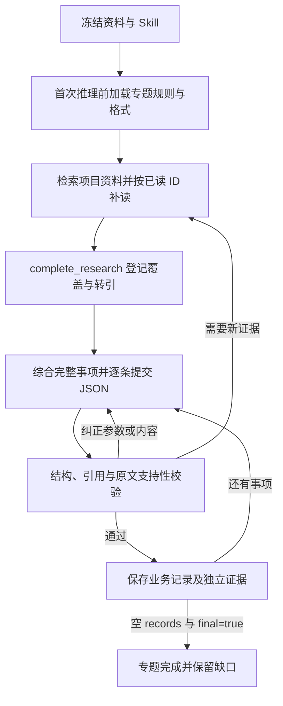

# 解析 Skill 与运行护栏

更新日期：2026-10-18。适用范围：专题解析；运行时版本 `deepagents-0.7.22-v5-records`，业务数据与展示格式版本均为 `1`。

## 职责与流程

控制器冻结资料版本、Skill 和执行参数，调度 13 个独立专题。专题按业务问题检索、补读、综合和逐条提交；运行时管理权限、预算、支持性校验、持久化及终止。



只有真正新增原文才重新确认和综合；空检索或返回已读证据时保留已有成果。纠正受本次预算约束，耗尽时保留已核实内容并报告未完成，不把部分结果冒充完整成果。

## 本项目的 Skill 资源

资源位于 `apps/api/src/tender/resources/parse_skills/`。根目录参考 Skill 只提供领域素材，不是运行入口。数据库模块键和源码目录保留下划线，Skill 名称及虚拟目录使用连字符。

每个专题包含：

- `SKILL.md`：专题目标、边界、识别方法和项目检索流程。
- `references/output_schema.json`：机器格式声明，沿用 `version/sections/title/layout/columns`，定义允许的分类、布局与中文内容键。
- `references/output_format.md`：事项组织、字段含义及真实 JSON 提交示例。
- `references/coverage.json`：需要核对的业务主题；遗漏、未命中和未解决分别保留状态，不为了填写清单编造结论。
- 业务细则和示例：有品类差异的专题按工程、货物、服务分类；格式专题另有正文定位、层级和目录过滤规则。

通用提交协议由运行时工具 schema 及系统规则提供。专题资源专注业务判断，不复制另一套重试次数、批次数量或权限规则。

### 参考内容的取舍

保留数值精度、类似项目定义、证明材料、岗位资格和格式关系等有用的识别方法。所有行业名词、常见位置和样例都是检索线索，不能直接作为当前项目义务。

价格专题区分投标报价折扣率和评分基准系数，即使同用K等字母也按原文定义判断；纯评分公式及其附件转引由评分专题核对，报价仍保留算术修正、异常低价说明与对应后果。该边界用于避免无关检索消耗预算，不省略真正的报价条件。

- 商务专题聚焦交易及合同履约，不把资格、业绩和评分要求混入合同条件。
- 否决专题需要明确的否决后果；“必须”、星号和风险经验本身不能证明废标。后置否决结论与资格清单应共同引用。
- 技术专题仅提取项目背景和技术方案要求。工程、货物、服务细则均围绕任务、方法、集成、实施及保障方案编写；参数仅作为方案约束，纯参数清单排除。
- 评分专题保留同项的全部公式、档次、条件和扣分，区分否决条件及合同考核，不能按表格物理行拆散评分项。
- 保证金未命中登记缺口，原文明示免收才输出有引用的事实。不同标段的不同限价分别声明适用范围。
- 格式专题使用父子节点表达已证实的全部层级，不限定三级；逻辑标容器、物理分册和独立附件分别判断。

示例使用 `blocks` 与 `submissions` 演示容器，分别表示模拟的已读原文和按顺序调用工具的参数。实际逐个发送 submission，不把整个示例容器或多条记录数组提交给工具；样例名称、数值和 ID 不能作为真实任务证据。

## 加载、快照与兼容

创建报告时冻结全部 Markdown、JSON 资源及 Skill 版本。首次推理前加载当前模块正文、输出说明、核心细则和已明确项目/标段品类的规则；混合品类分别加载，不默认服务类。示例通过受限 `read_file` 按需读取。

`output_schema` 直接读取报告冻结的 JSON 声明，拒绝错误版本、布局、空分类、重复分类/列名及多余属性。模型与前端消费同一份声明，不再从新资源的 Markdown 表格反推结构。

兼容按当前模块快照中是否存在 `output_schema.json` 区分：

- 新快照采用原生声明及适配后的品类规则，技术专题正常加载对应品类细则。存在但无效的声明报资源错误，不能回退到旧模板。
- 无声明的旧快照沿用原 Markdown 解析及旧加载逻辑，包括旧技术专题不加载其冲突的参数细则。旧报告展示、恢复与补跑不从当前磁盘补入新规则。

模块内容哈希覆盖其冻结资源，包括格式声明、品类细则和示例。恢复继续使用原快照，若要使用新 Skill 应新建报告。此次资源适配不改运行时版本、HTTP 接口、前端类型或数据库结构，不需要迁移。

## 检索来源与原文证据

`list_documents` 返回授权资料的 ID 与说明；`search_document` 限定本项目资料，`search_knowledge` 限定关联参考库。历史资料不能替代当前项目依据；参考建议也须同时引用本项目相关要求。

检索和补读返回的每块仅含 `id/text`：

```json
{"blocks":[{"id":"s1r2c3","text":"原文内容"}],"already_read":[]}
```

来源、版本、相似度、页码及坐标留在服务端证据账。`read_document(block_id, before=2, after=2)` 只能围绕已读块补读，最多十二块；不能猜测 ID、偏移或磁盘路径。表头、脚注、跨块条件和章节来源都要从实际原文核对。

达到单次返回上限且仍有达标候选时，工具额外返回 `search_limited=true` 和 `search_hint`，提示按未覆盖子主题或限定资料继续检索。重复同一查询不会翻页；该提示不暴露额外原文、分数或位置，也不替代累计证据预算警告。没有截断提示仅表示本次候选未超窗口，不证明该主题已完整覆盖。

关键词回退真正空召回时，`search_hint` 提醒拆分组合查询、采用单一核心概念或原文短语；不自动降低阈值，也不因已读块去重后 `blocks` 为空而误报未命中。语义检索空结果不套用关键词说明。

编号清单、评分表和格式正文可能超过一个邻域窗口，应沿边界处已读 ID 继续补读到该事项结束；预算不足时登记未读部分。同一上传文件也可能夹带历史模板或其他项目条款，须核对项目名称、采购主体和编号，明确不适用的内容不能进入本项目结论，归属不明登记缺口。

“详见附件/某章”等是继续检索的线索，按目标名称和业务主题追踪实际条款。目标缺失、循环或预算不足时登记缺口；完整义务后的出处和标准号不一律删除，也不要求联网读取外部标准全文。

`complete_research` 确认主题状态和转引处理后进入综合阶段。真实查询与读取记录由服务端保存，不要求模型精确复述检索词；覆盖形式缺项降为待核对说明，不阻断已核实正文。

综合阶段每轮提供已登记的主题发现、原样证据 ID、转引和资料缺口，替换此前逐轮重复的检索流水，防止历史压缩后只处理最近一项。提示按阶段选择：研究阶段要求检索和登记；综合阶段要求继续提交尚未处理事项，不再重复要求启动全主题检索。交接是待核对线索，不是已验证成果或可复制的原文；已提交事项仍以校验后的暂存记录为准。`complete_research` 的成功回执同时返回实际登记的缺口。

转引 `resolved` 表示已读到目标实质条款，找到另一处索引或格式标题不等于附件已提供。主题部分有据、部分仍未决时应声明 `unresolved`，继续提交其他有据事项。工具描述和运行时均说明这一语义；服务端仍只验证证据身份，不能仅凭状态枚举保证模型的覆盖判断正确。

综合后检索或补读带入新块时，工具当次返回 `phase=research` 和重新登记、综合的提示；旧暂存事项按既有规则失效，不能继续作为最终结果。该提示不进入读缓存，重新完成研究后的缓存重放不会误报阶段变化。只校正引文字面时使用 `read_document` 的 `before=0, after=0` 回读已知块，不因邻域意外引入新证据。

## 逐条提交与消费

`submit_analysis` 每次 `records` 最多一条完整事项，`final=false` 逐条保存；全部处理后用 `records=[]`、`final=true` 收尾。一条事项可以综合多处证据，关键数值、条件、档次和独立任务不能因概括丢失。

引用已经整理好、没有先后依赖的事项可在同一轮推理中分别发起多个单条提交；工具仍串行写入并逐条保存，后续校验接收这轮待核实事项，减少每条都另起一轮生成的开销。父子节点、关系端点及纠正依赖必须等待前一步成功，显式收尾在本轮校验之后进行。

记录的 `content` 使用当前分类的中文键，值为非空字符串或字符串数组；无依据的键省略。`citations` 独立填写已读 `block_id` 与连续原文 `quote`；`text`、位置及发布后的 `evidence_ids` 由服务端生成。

生成时主动归纳正文重点，去掉套话和重复表述，用短句、字符串数组与少量 Markdown 加粗改善阅读，不额外调用模型做展示改写。金额与单位、期限与起算点、主体、范围、数量、且或、否定、前提、例外、证明材料及评分档次完整保留；名称、编号、材料标题、公式不改写，“原文摘录”列保留原句。排版只用于 content 文字值，不输出 HTML、代码块或嵌套表格，结构化属性保持纯文本。支持性校验按去除排版后的语义核对，quote 的逐字规则不放宽。规则用于后续生成，不自动改写或重跑已有报告；提示和离线协议测试不证明真实模型一定正确归纳。

同一事项的多处引文改写会一次返回全部错误块，便于一起回读纠正；不会自动把摘要改写成原文，也不放宽逐字引用检查。需要补全条件时仍应读取邻域并重新综合，不能为了保留暂存结果跳过必要补读。

支持性校验允许中文边界的等价结构化，例如“不超过”对应`<=`；扩大或收紧允许范围均错误，不能把`<`与`<=`视为相同。完整事项可由多处独立引文共同支持；只有连续原文、父子归属或修订关系等断言才需要相应关系证据，不要求所有综合引文都物理相邻。模型对这些规则的实际遵循仍需验收。

价格构成按独立事项组织，通常包含费用与特定条件下另付费用分别保留条件和引用；计税附件缺失单独登记，不用转引占位代替已完成计算规则，也不丢弃已明确的费用包含要求。服务类资源提供完整的模拟原文、逐条JSON及缺口示例。

`key` 是模块内稳定身份。范围使用 `common/lots/unknown`，`lots` 填原文标段编号或名称；未知不推定公共。数值条件、证明材料、评分属性与正文一起接受支持性校验。格式节点先保存父级再用 `parent_key` 关联，关系端点同样先保存，修订和冲突均保留双方依据。

原文明示各标段共同适用可使用 `common`；展开为具体标段名称时，应另有引文证明名称及适用性。送审数据省略未声明的空属性与默认空条件，避免将 `materials=[]`、`scoring=null` 误判为“没有材料/评分要求”；实际填写的条件、材料、评分与父子关系仍完整校验，持久记录及纠错身份不变。

证据选择后，运行时确定性核对每个 `lot_refs` 能否在最终引文中找到对应原文编号或名称（忽略空白和全半角）。只在旁边上下文出现、或者名单引文被模型去重删除，都不能放行。该检查不代替适用性判断：名称出现仍须通过条款与范围的语义校验；`common/unknown` 不强制补造具体名单。

`coverage/gaps/research_summary` 可以省略，服务端沿用研究账并补充待核对主题。显式提交的内容缺口清单不会静默清除未解决的研究或转引缺口；“不适用”需要引用支持，检索未找到不等于全文没有要求。

业务记录与证据分别保存在 `business_data.records/evidence`。新结果增加 `content_evidence`，按内容列与数组序号保存所选证据 ID，字符串列视为一个单元；`evidence_ids` 包含整项及各单元选中的全部出处。`GET /api/v1/analysis/reports/{report_id}/modules/{module_key}/records` 返回独立记录、证据及冻结的 `output_schema`，前端解析逐条绑定后展示和定位；请求或绑定校验失败只标记当前专题，其它专题继续加载。必要引用失去权限时整条隐藏，不留下部分有据的完整结论。

逐条绑定复用 `verify_items` 的同一次支持性请求：整项值保留原有范围、条件及跨来源检查，附加的正文单元分别选择支持自己的证据。正文单元可以只选某个来源，整项不能因此删去跨来源必要证据；选择非候选 ID、遗漏单元或返回空绑定均视为格式错误。所有单元通过后才保存绑定，公开展示仍只有原整项值。逐条出处与整项采用不同等价引文时，两者均保存，报告投影也把额外出处加入既有权限检查。送审时每项的相同候选集合只在 `evidence_sets` 保存一份引文与上下文，值通过从零开始的 `evidence_set` 索引引用；同块不同摘录仍属不同集合，任一共享值需要核对章节时保留该集合的邻域。选证输出协议及逐值候选校验不变，不增加数据库结构、模型调用步骤或生产预算。

界面以专题正文为主入口，按字段语义展示成对事实、完整条款、报价对照表和可折叠格式树；事项标题、适用范围和修订关系单独呈现。支持专题、分类、范围、全文关键词和待核对筛选；范围浏览保留原始条款，正式有效要求仍由单标段 context 接口决定。新结果以同一事项为定位去重边界，跨正文单元、跨列和补充依据合并位置；每个位置只在首次出现的可见正文后显示一个图标，不同事项各自保留入口。文件名、页码和完整摘录放在悬停说明中。同一资料、文档版本、解析批次及原文块的不同摘录合并为一个图标，全部摘录保留在提示中；点击仍使用一条真实引用，不拼接引文；原文面板可点击、触屏或键盘展开当前事项在该位置的全部原始摘录，区域可滚动，不混入其它事项或位置的引用。条件、材料、范围及字段标签等未被正文入口覆盖的出处保留为“补充依据”，不重复集中显示已定位的正文来源，也不猜测额外出处与详情条目的对应关系。文档只显示当前定位的单个3px深紫描边框及反向定位角标，内部透明，切换后移除旧框；无块坐标时使用页级虚线框，其他页不画框。多条结果共享同一原文时，反向定位优先回到刚点击的事项，并按资料、文档版本、解析批次和元素共同匹配，避免跨版本串用。

模块采用直接铺开的标签切换，桌面换行、手机横向滚动，空模块与运行状态也保留。报告顶部“刷新结果”后依次提供单模块重新解析、补跑未完成模块和全部重新解析，分别使用当前单模块键、由服务端选择未完成模块、全部模块键确定范围；全部专题视图禁用单模块重跑。分析记录按次显示开始／结束时间及失败／停止原因，后续成功不覆盖前次原因；时间缺失不推算，运行中结束时间显示“尚未结束”。重跑操作不收进运行详情，运行中及旧流程报告的限制沿用既有规则。

新冻结的项目概况、人员要求声明 `scalar_columns: ["字段"]`，要求字段名为单个字符串，不同事实逐条保存；内容仍可使用字符串数组保留条款清单。未声明该属性的旧快照继续按原协议解析。按用户明确的展示要求，字段与内容使用两列KV表格；多字段数组与内容数组按原顺序逐行对应，单字段的多条内容保留在同一格。数量不符时保留全部原始项并标出缺失，加入待核对列表；拆行后的定位仍取原内容序号，事项锚点保持唯一。此展示不改写持久化数据或后端输出约束；重试旧报告仍沿用旧快照，采用新规则需新建报告。

报告终态后按既有规则发布追加式业务快照，编制取数要求明确标段并验证来源权限及快照有效性。详见 [设计19：Agent检索与专题汇总](../设计/19-Agent检索与专题汇总.md) 和 [设计05：后端API设计](../设计/05-后端API设计.md)。

## 预算与验证

权限、总调用预算、证据预算、时限、纠正次数及恢复由运行时控制，以本次冻结参数和错误反馈为准。连续无进展与收尾纠正分别由 `analysis.max_no_progress_rounds`、`analysis.max_finish_corrections` 管理；它们不替代同一事实的校验失败额度。工具重放和检查点恢复不清零预算，模块不能递归委派。

专题在模型或工具剩余次数进入冻结总额的最后四分之一时停止扩展搜索，预留研究登记、必要补读、逐条提交、支持性校验和显式收尾。时间预留规则继续生效；补读与提交仍受原硬上限约束，不增加配额。剩余次数读取运行账，包含Skill加载、登记、提交及错误调用；未完成主题必须保留缺口，预留策略不表示当前证据已经完整。

对话压缩使用当前专题的摘要指令，保留事项、关键条件、证据ID、提交状态与具体缺口，合并重复日志。较早摘要不覆盖当前研究账和工具结果；缺失附件不变成获取未授权资料的前置条件。原文仍保存在证据账并可回读，摘要不能作为引用提交。触发阈值、保留消息数及总预算不变，实际摘要的遗漏和冗余仍需通过模型验收观察。

在项目根目录运行：

```powershell
& scripts/check-backend.ps1
```

统一检查包含 Ruff、架构契约、全部 unit/contract 和端口/真实装配 mypy。资源回归直接校验 13 份原生声明与真实旧模板的接口一致性、全部 JSON 示例的结构及引用、品类加载、冻结快照与损坏声明，并通过可控模型运行实际 Agent 图验证缺口、逐条保存和证据分离。

资源测试验证结构及确定性行为，不能证明真实模型已经正确遵循全部领域规则。数据库集成使用隔离环境，现场模型效果需要真实资料另行验收；本轮资源适配不自动启动服务或改写已有报告。
