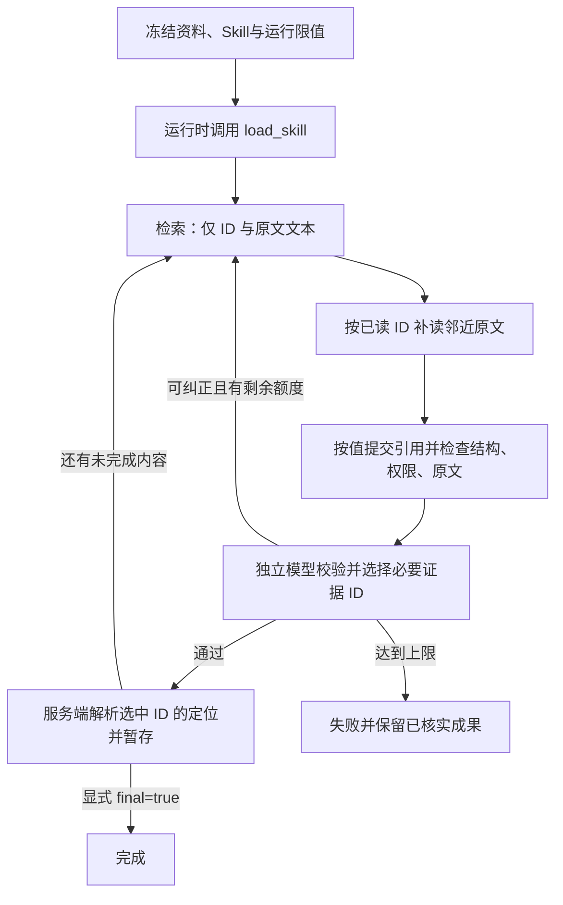

# 解析 Skill 与运行护栏

适用范围：`apps/api/src/tender` 的专题解析，运行时版本 `deepagents-0.7.22-v2`。

## 职责与流程

控制器固定资料版本并调度 13 个独立 DeepAgents 模块。模块内部按 Skill 使用检索、补读、提交工具；运行时代码控制权限、失败次数、预算和终止。禁止模块再次创建或递归委派子 Agent。



图中的纠正边受剩余次数、无进展检测和总预算共同约束，不允许无限循环。

## 项目内 Skill

业务规则位于 `apps/api/src/tender/resources/parse_skills/`，不是直接执行仓库根目录的参考 Skill。

- 保留专题边界、识别规则和品类细则；技术模块包含参数表，格式模块保留独立父子节点。
- 将参考 Skill 的文件检索与 Markdown 直接回复改成项目原生工具及结构化提交。
- 数据库模块键和资源目录保留下划线；Skill 名称与虚拟目录使用连字符，例如 `/skills/project-basic-info-parsing/`。
- 创建报告时保存全部 Markdown 快照和版本；`load_skill` 确定性读取当前模块正文与输出清单，计入工具预算，记录 `skill_loaded` 事件及模块内容 SHA-256。
- 正文与输出清单进入每次分析调用的系统规则，防止压缩后丢失；品类细则、实例通过受限 `read_file` 按需读取。模型不必再决定是否加载核心 Skill。
- 同线程恢复检查内容哈希，不能混用更新后的规则；项目资料正文、工具返回中的指令不得改变规则或权限。

## 模型可见的数据

检索与补读的 `blocks` 只包含：

```json
{"blocks":[{"id":"s1r2c3","text":"原文内容"}],"already_read":[]}
```

`already_read`、预算耗尽提示等是控制反馈。检索诊断、分数、页码、坐标、文件和版本元数据保存在服务端证据账，不进入候选块。问答接口仍使用原协议，本次变更限定在专题解析。

`list_documents` 返回资料的 ID 与说明文本，帮助区分项目与参考来源；资料 ID 与证据 ID 用途不同。`search_document` 和 `search_knowledge` 分别限定项目与参考资料，服务端拒绝检索结果混入所选范围之外的资料。

`read_document(block_id, before=2, after=2)` 只能围绕已读证据补读，最多 12 块；服务端解析来源、版本和偏移。不得猜测位置。表头、标题、脚注和条件缺失时补读其原文，不能用技术元数据替代业务依据。

提交仍使用 `citations:[{block_id,quote}]`，`block_id` 填入检索返回的 `id`。每个值单独绑定连续原文；未检索到的内容只写 `research_summary`。

## 必要证据与定位

独立校验模型的每条原文证据也只有 `id/text`，上下文不带坐标或页码。校验响应必须包含：

```json
{"reviews":[{"supported":true,"unsupported_claims":[],"unresolved_references":[],"evidence_ids":[["s1r2c3"]]}]}
```

`reviews` 与字段一一对应，`evidence_ids` 与该字段的值一一对应。服务端校验数组长度、类型、ID 唯一性、引用归属，以及通过结论的非空证据集合。不能借用别的值或仅在校验上下文出现的 ID。

`unresolved_references` 是必填字符串数组，逐项列出值序号及尚需展开的文件、章节或条款；无待展开指向时返回 `[]`。支持性与解析完整性分别检查：即使转引句逐字来自原文、`supported=true`，只要仍有待展开指向就退回该字段，不定位、不发布。缺失或类型不符沿用首次加两次的格式纠正上限。

- 对同一事实，选择最直接、完整的一处；必须针对选中的证据集合判断支持性，不能先通过再任意裁剪。
- 跨块条件、不同标段、冲突以及修订双方保留必要证据。跨来源结论至少保留各来源一处，保守避免误删修订前后依据。
- 不使用模型自报概率或检索相似度证明可信度；证据不足则不输出结论。
- 不同批次的同一事实已经分别验证充分，且分组、字段、取值、备注和来源集合一致时，选引用数量更少、摘录更直接的一套；备注中的主体、起算点等条件不同则分别保留依据，不拆散已验证的证据组合。
- 通过校验后，服务端只解析保留 ID 的真实元素位置，再暂存和发布。证据账仍保留候选原文用于追溯，报告只携带最终引用。

## 追踪转引到实质要求

“评分标准详见第三章/某附件”“按前附表执行”等内容是检索线索，不能代替解析值。解析 Agent 按目标名称、条号和业务主题继续 `search_document`，跨文件先用 `list_documents` 核对授权资料并限定 `source_id`，命中后用 `read_document` 补读表头、条件和细则。多级转引追踪到实际条款，结果和引用均包含实质要求，不能把细则只藏在引用中。

独立校验在既有请求内检查待展开指向并返回可执行的纠正反馈，不另开无预算约束的模型或检索循环。目标缺失、循环或预算不足时，只在 `research_summary` 说明追踪路径与未取得内容，已核实的其他要求仍保留。仅凭“满分20分，评分档次详见附件”不能宣称已提取评分细则；同一评分项的各档得分、公式、扣分条件可用多句或换行完整呈现。

判断依据是字段的实际含义，不按“详见”等关键词一律删除。正常标准号、明确的材料提交义务、修订关系及完整要求后的出处仍可保留，不要求读取外部标准全文。独立的评标方法和分值构成按其真实范围输出。此检查仅用于专题解析，问答仍可回答条款位置问题。

已有报告不会自动改写；要消除旧结果中的索引占位，应重新发起分析以使用更新的 Skill 快照。

## 失败、进展与预算

下列配置随 attempt 固定，默认值及数据库种子见迁移 `0010_analysis_guards.py`。

| 配置 | 默认 | 行为 |
| --- | --- | --- |
| `analysis.max_tool_failures` | 3 | 全局连续失败或同一工具连续失败达到上限即停止；其它工具成功不能清除该工具失败账 |
| `analysis.max_no_progress_rounds` | 3 | 没有新增证据或已核实事实时进入收尾，禁止新检索；再无进展 2 轮停止 |
| `analysis.max_identical_tool_calls` | 3 | 同工具、规范化参数累计上限；相同只读请求复用结果，仍计入总工具预算 |
| `analysis.max_validation_failures` | 3 | 同字段或同事实累计失败上限；事实按取值、分组、备注与引文区分，仅改字段名不能重置，不同断言共用引文不串账 |
| `analysis.max_subagent_retries` | 2 | 本地连接或检查点临时故障最多恢复 2 次；权限、取消、拒绝、模型路由耗尽不整轮重试 |

其他固定保护：校验响应格式最多首次加 2 次纠正；输出截断最多 3 次拆分反馈；连续 3 次无效提交或自然语言冒充完成即停止。更早达到任一上限均会终止。

主分析、独立校验、摘要、网络重试和换模型共用模块实际请求预算；默认 40 次模型请求、48 次工具调用和 1800 秒总时限。SDK 不另加隐式重试。上下文按既有 80% 阈值压缩。

错误反馈包含 `error_code`、`tool`、`message`、`remaining_attempts`、`next_action`。引用失败指出具体字段和失败原因；无依据则省略，已通过部分不要求重复提交。

同 `tool_call_id` 重放不会再次消费工具额度或增加错误次数；重放前仍检查权限。缓存结果、纠错账、无进展状态和恢复次数持久化；恢复不重置截止时间。重试次数必须先保存，保存失败则终止。

用户主动补跑才创建新 attempt：清理旧调用缓存和失败计数，保留符合条件的已核实成果。自动恢复沿用原 attempt，不能借新线程获得无限额度。

## 发布与验证

部署时先在 `apps/api` 执行 `uv run alembic upgrade head`，再重启 API 与 worker(完整命令与顺序见 [17-数据库迁移](17-数据库迁移.md) 第 8 节)。该迁移只添加 5 个配置定义，不改活动配置发布或历史报告。

v1 报告仍可查看，不能用 v2 工具协议继续其旧检查点或补跑；需要在界面重新发起分析生成新报告。不要直接改旧报告的版本号。

验证命令：

```powershell
uv run pytest tests/unit tests/contract -q
$env:TENDER_RUN_DB_TESTS = '1'
uv run pytest tests/integration/test_deepagents_runtime.py tests/integration/test_knowledge_flow.py -q
uv run ruff check src/tender/
uv run lint-imports
```

集成测试使用隔离 PostgreSQL schema 和可控模型：覆盖 13 模块调度、Skill加载审计、恢复预算、动态权限、精选ID定位与配置迁移；不调用真实供应商或写业务报告。
