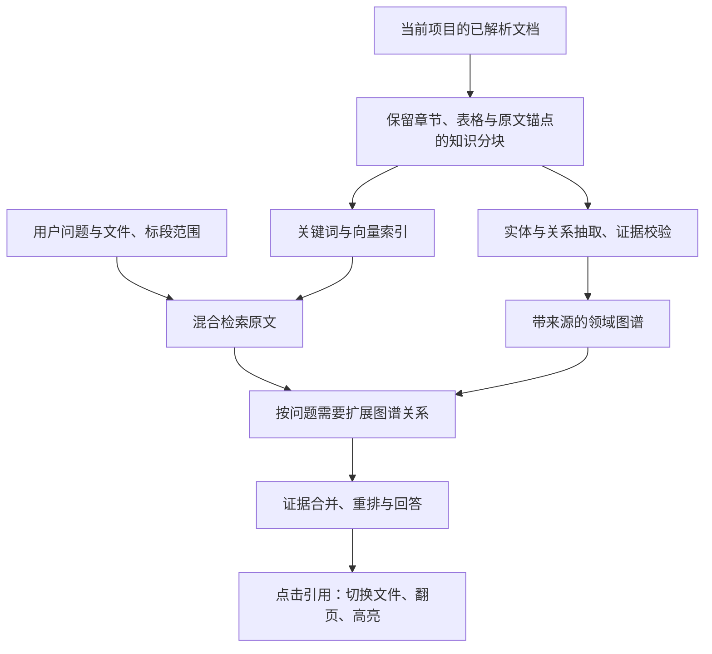

# RAG 与 GraphRAG 项目知识检索

更新日期：2026-10-03

状态：本文件保留最初接入设计。2026-10-04 用户确认加入通用多知识库管理并开始实施，最新实现范围、接口、DDL 与验证见 [14-知识库与综合分析实现](14-知识库与综合分析实现.md)。以下“尚未实现”等描述保留为原设计时点，不能用来判断当前代码进度。

## 1. 第一版解决的问题

在当前项目的招标材料内生成开放内容的智能分析报告，并支持查条款、关联资格条件、证明材料和废标风险，每项事实及关联判断均能定位原文。分析采用必检主题与自主发现相结合，不以既有固定字段作为结果范围上限。

典型问题：

- “第二标段要求哪些资质，分别要提供什么证明？”
- “项目负责人需要满足哪些条件？不满足会有什么后果？”
- “这条资格要求在评标办法中有哪些对应规定？”

第一版来源范围限于当前公司、当前项目中明确选定的文件与解析版本。后续标书检查与历史标书复用的接口和数据边界现在纳入设计，功能分期实现，见第 10 节。企业资质匹配和外部法规检索另行扩展。项目内多文件关联属于本次新增范围；不自动裁决原文件与补遗之间的优先级。

## 2. 两种检索如何配合

| 能力 | 处理方式 | 适用问题 |
| --- | --- | --- |
| RAG | 关键词与向量共同召回原文，合并排序，按需重排 | 金额、日期、资质名称，以及不同措辞表达的同一条件 |
| GraphRAG | 从召回条款对应的实体出发，沿有原文支持的关系扩展，再取回证据 | 资格要求对应什么材料、适用哪个标段、违反后有什么后果 |
| 回答生成 | 综合证据，逐项给出结论、依据及无法确定的部分 | 让用户核对结果，而非只看到一段无法查证的回答 |

本方案中的 GraphRAG 指图谱增强检索方法，第一版采用领域图谱和局部关系检索，暂不绑定 Microsoft GraphRAG 框架。全库社区摘要与全局检索可在跨项目需求出现后另行评估。



简单事实问题直接使用原文检索；关联问题增加图谱扩展，避免每次问日期或金额都付出多跳检索成本。关联关系不能仅凭文本相似度或两个实体共同出现而成立。

## 3. 可以复用的实现与缺口

| 位置 | 已有基础 | 接入工作 |
| --- | --- | --- |
| `application/extraction.py` | 章节路径、锚点文档、分块、关键词选段 | 新建知识检索分块，保留原始块映射 |
| `element` / `parse_run` | 页码、bbox、原文、解析批次 | 作为索引与图谱的共同来源 |
| `api/documents/versions.py` | `anchors/resolve` 支持指定解析批次 | 回答引用必须传递明确的版本和批次 |
| `worker/documents/tasks.py` | 解析落库与独立抽取任务 | 解析落库后安排独立知识索引任务 |
| `ports/llm/chat.py` / 模型管理 | 文本生成、模型路由、供应商配置 | 新增向量模型端口及能力类型，按需增加重排能力 |
| 前端核对工作台 | 文件切换、PDF 查看与证据高亮 | 增加项目问答入口与关联证据列表 |

现有抽取分块面向模型抽取，按约 12,000 字符组织，单个原文块的渲染可能截断到 6,000 字符。知识索引不能直接复用截断后的字符串，否则长表格中的条件可能永久丢失。应从完整 `element.text/html` 构建知识块，按模型 token 上限和章节边界切分，表格保留表头及跨页关系。

保留现有字段抽取链路供兼容与对照，新增动态分析报告及项目问答；报告不能只是固定字段的重新排版。只有评测证明召回覆盖没有退步，才考虑替换原有抽取中的选段逻辑。

## 4. 建议技术与模型配置

- 向量存储采用现有 PostgreSQL 加 `pgvector`，复用项目、文件和事务基础。需在开发与部署数据库中验证扩展可用性。
- 关键词检索复用现有文本检索基础，评估中文分词；中文全文检索不能直接假设英文默认分词配置可用。第一版可用现有 trigram 匹配，结合字段词与精确名称检索评估效果。
- 图谱先使用 PostgreSQL 的实体表、关系表和证据关联表，提供受类型、范围与深度限制的遍历。图谱规模与遍历延迟需要时，再评估独立图数据库。
- 向量模型选支持中文和招投标术语的内网可用模型；问答与关系抽取复用模型管理的供应商基础，但设置独立功能绑定。具体模型需结合现有服务能力测试后决定。
- 向量模型、维度、归一化方式、分块版本组成索引配置。索引和查询使用同一嵌入空间；模型更换需要重建，不能沿用聊天模型的任意故障转移规则混用向量。

## 5. 图谱的最小领域模型

第一版实体：标段、资格条件、人员条件、证明材料、评审条款、否决后果。

第一版关系示例：

```text
标段二 ──要求满足──▶ 项目负责人条件
项目负责人条件 ──需要证明──▶ 注册证书
项目负责人条件 ──受条款约束──▶ 资格评审第 X 条
资格评审第 X 条 ──规定不满足后果──▶ 否决投标
```

这些是模型形状示例，不代表真实项目已存在这些事实。

实体合并必须考虑项目、标段和文件语境，同名资质或人员角色不能直接合并。条件记录应保留金额/日期比较符、有效期、适用范围，以及“且 / 或 / 除外 / 不得”等限定；实体之间的一条裸边不足以表达复杂资格逻辑。

每条关系保留原文证据、抽取模型与版本、验证状态。推断路径在回答中明确标为分析，逐条引用路径上的依据；存在图路径本身不能证明结论成立。

## 6. 数据、版本与证据约束

建议新增的概念表：

| 表 | 责任 |
| --- | --- |
| `knowledge_source` | 原始文档身份、来源类型与版本，关联既有文件；不以某次问答的项目范围代替来源身份 |
| `knowledge_collection` / `knowledge_membership` | 知识集合及来源归属，第一版仅开放项目集合，后续支持有权限约束的历史资料集合 |
| `knowledge_index` | 某来源解析批次与索引配置的构建状态、覆盖情况；同一原文索引可关联多个获授权集合 |
| `knowledge_chunk` | 完整来源映射、章节、文本和向量 |
| `knowledge_entity` | 有类型和适用范围的实体 |
| `knowledge_relation` | 有方向、条件和验证状态的关系 |
| `knowledge_evidence` | 知识块、实体或关系与原文元素的关联 |
| `knowledge_answer` | 问题、范围快照、结论与引用，供后续核对 |
| `analysis_report` / `analysis_item` | 报告版本、动态章节与分析条目、分类和分析规则快照；证据关联到具体结论、列表项或表格行 |

正式 DDL 在实现时与迁移、契约测试一同确定。

关键不变量：

1. 引用至少保留 `source_id`、来源集合、来源所属的 `project_id` / `project_file_id`（项目文件适用）、`version_id`、`parse_run_id`、`element_id`、`anchor`、原文片段；页码与 bbox 从对应原文元素解析。`anchor` 仅在一次解析批次内有效。来源所属项目与发起问答的项目分开存储，未来引用历史资料时不重写来源归属。
2. 向量检索、关键词检索、图谱扩展、引用读取都执行服务端公司、项目和集合授权校验。第一版允许来源仅为当前项目，后续历史复用由独立用途策略开放明确获授权的历史集合。不能先全库召回，再让模型自行过滤。
3. 每次问题固定用途、获授权集合、参与文件、业务适用时间、解析批次和知识索引版本，防止处理中范围或索引更新导致新旧证据混用。
4. 重新解析产生新的索引版本。索引完成后再发布；新批次处理中明确提示，旧答案继续指向旧批次，不默默改绑。文件删除或撤权后立即排除其检索与引用访问，索引清理可异步执行。
5. 每个事实性结论携带支持它的证据。锚点存在和引用原文一致只是机械校验，还须检查证据是否支持结论。
6. 部分解析、图谱抽取失败和无证据分别展示。无检索结果只能表述为“当前可用材料中未找到依据”，不能断言不存在该要求。
7. 招标材料中的指令文本属于待分析数据，不能改变系统的检索范围、回答规则或工具权限。

## 7. 问答与风险汇总分开处理

具体问答采用混合召回、候选融合、图谱局部扩展和证据重排。扩展建议从有限深度开始，对关系类型、候选数量和耗时设置预算，具体参数由评测确定。

“列出所有废标风险”属于覆盖型任务，不能只取向量相似度最高的若干块。需要结合全文条款扫描、已有开放式字段抽取、章节覆盖记录和图谱关系整理。结果展示已处理文件、缺失页或失败部分；未经覆盖核验和人工复核，不能宣称穷尽所有风险。

原文存在冲突时并列呈现双方证据，并提示需要复核。没有企业资料时只回答招标条件及其后果，不判断某企业一定具备或缺失资格。

## 8. 接口与界面建议

以下为待实现接口，当前不可调用：

- `GET /api/v1/projects/{project_id}/knowledge/status`：文件级索引状态和覆盖范围。
- `POST /api/v1/projects/{project_id}/knowledge/reindex`：按指定文件与配置异步重建索引。
- `POST /api/v1/projects/{project_id}/knowledge/ask`：提交问题、文件范围和可选标段。

问答响应包含逐项结论、引用列表、关联路径、证据不足或冲突说明、使用的索引快照。首版优先返回完整且已校验的回答，再按响应延迟需求增加流式传输。

前端入口使用“项目问答”，回答按“结论—关联条件—原文依据”展示。点击依据复用文件切换和 PDF 高亮；首版以可读的关联列表表达关系，交互图谱可按实际需求增加。

## 9. 实施顺序与验收

1. 建立模型能力配置、向量端口、来源与集合数据、索引及异步任务，完成原文混合检索、范围校验、版本快照及失效处理。
2. 完成一级分类选择、动态分析报告和项目问答，贯通逐项引用与点击原文定位。
3. 增加实体关系抽取、证据校验和局部图谱检索，支持资格与废标条款关联。
4. 补充覆盖型风险汇总与专项质量评估；索引重建与失效处理属于第一版基础能力。

第一版整体交付包含前 3 项，不能把只有向量问答的阶段称为 RAG + GraphRAG 已完成。

评测比较现有关键词检索、混合 RAG、RAG + GraphRAG，使用同一批项目问题与可核对证据，记录召回覆盖、回答依据、引用定位、延迟和模型用量。重点覆盖：否定与例外、同名实体、不同标段、长表格、文件冲突、解析缺页、重新解析、跨项目隔离。若图谱没有改善关联问题，应调整实体与关系质量，而不是仅增加图展示。

索引构建和图谱抽取增加模型调用成本，应与文档解析状态分开记录；图谱暂不可用时可明确降级为原文问答，不能声称已完成关联分析。

## 10. 面向标书检查与历史复用的共用设计

用户已明确这两个后续用途。建设统一的资料解析、索引、检索与证据服务，上层分别实现问答、检查和复用流程。第一版落实会影响数据与接口兼容性的基础约束，后续业务表和界面随对应功能增加。

### 10.1 三种用途与来源身份

| 用途 | 主要来源 | 检索后的业务处理 | 输出 |
| --- | --- | --- | --- |
| 项目问答 | 当前项目招标文件、澄清、补遗 | 原文解释与关系分析 | 有引用的回答 |
| 标书检查 | 当前有效招标要求 + 指定版本的投标文件及附件 | 逐条要求寻找响应，校验条件、覆盖和冲突 | 要求与响应双向证据、检查结果、待复核项 |
| 历史标书复用 | 当前要求 + 获授权的历史标书或复用素材 | 筛选适用案例、返回完整章节、识别需修改内容 | 带出处的参考段落、适用条件、差异与替换清单 |

同一段文字进入不同流程时，其证据用途不同。招标要求、投标响应、历史参考必须分别标记。历史标书中写过某项资质或承诺，不代表当前企业具备该资质或本次投标已作出该承诺。

现有 `project_file.role` 主要表达招标包内的 `main/clarification/addendum/boq/drawing/format/other`。新增来源分类需独立记录“招标材料 / 投标材料 / 历史参考 / 经整理的素材”，并保留细分文件角色；不能把投标正文和招标正文都作为无区别的 `main` 使用。

### 10.2 第一版就应确定的数据与检索契约

- **来源与集合分离**：来源记录原始文档与版本，集合记录项目或知识库中的可用范围。后续历史归档通过关联来源实现；原文索引复用不扩大访问权限。经脱敏、改写的素材具有新版本和父来源关联，不能冒用原文锚点。
- **保留业务元数据**：公司、原项目、来源分类、文件角色、章节路径、标段、文档日期和版本从第一版保存；行业、项目类型、地域、有效期、复核状态、复用状态等可选字段按用途补充。缺失值保持未知，不能由上传时间推定生效时间。
- **分层分块**：检索用较小子块定位，回答或复用时按需展开父章节、完整表格、相邻条款与附件引用。保留父子关系、原文顺序和字符区间，避免历史复用只得到脱离条件的零散句子。
- **用途驱动的检索接口**：核心请求表达 `purpose`、问题或要求、当前任务项目、来源集合、文件版本、文件类别、标段和业务适用时间。服务端以用途策略计算允许范围；客户端传入历史集合 ID 不等于获准访问。
- **统一证据返回**：检索返回原文片段、来源和版本、章节与锚点、命中原因、排序分数、覆盖信息。问答文本、检查结论和复用改写由各自流程生成，避免核心检索接口只返回聊天字符串。
- **领域实体与关系可扩展**：第一版条件与条款图谱保留类型、范围和证据；后续增加投标响应、证明文件、方案章节、复用来源及修订关系。跨项目同名实体不自动合并，每次遍历仍受获授权来源约束。

核心检索服务可通过内部应用层接口供各流程调用，不需要现在开放一个任意跨库查询的公共接口。检索相似度表示相关性，不能直接作为资格符合度或检查通过概率。

### 10.3 标书检查：要求清单与双向证据

建议流程：确认招标文件与补遗适用版本 → 全文抽取检查要求 → 固定被检查的投标版本 → 按要求检索响应及附件 → 规则校验与语义核对 → 人工复核。

检查项应记录：要求及其锚点、适用标段、条件表达式、响应证据、附件证据、检查规则或模型版本、检查结论、人工复核状态。条件表达式保留金额和单位、时间基准、数量、且/或及例外条件。

例如“提供近三年不少于两项类似业绩”，检索负责找到业绩响应与证明；检查还要依据招标文件对“近三年”和“类似”的定义，核对日期、去重计数、附件对应关系。文本相似或答案提到“两项”都不足以判定符合。

结果区分“有证据支持符合 / 有证据表明不符 / 当前范围未找到响应 / 无法判定”，并单独记录待复核或已复核。“未找到响应”需要展示已检索版本和覆盖范围，不能直接判为实际缺件。无法仅靠解析文本核验的签字、盖章、版式等项目交由相应视觉能力或人工确认。

历史资料可用于查找改进参考，但不得充当当前投标文件已经响应要求的证据。检查结论必须能分别打开招标要求原文与本次投标响应原文。

### 10.4 历史复用：适用性、修订与来源链

首轮历史能力先支持搜索与参考，再根据需求扩展辅助改写。检索结果保留原项目、原版本、适用行业/标段、复核情况、有效期或未知状态，以及是否获准作为复用资料。中标记录可以作为排序参考，但不能等同于某段内容已经验证正确。

复用时按当前招标要求检查差异，输出项目名称、招标编号、采购方、金额、日期、人员、业绩、资质及承诺等待核对信息。适合模板化的可变字段与正文结构分别保存；模板或改写稿是衍生产物，其事实仍需当前有效资料支持。

记录“当前采用内容 → 所依据的历史片段及版本 → 原始文档”的来源链和修改记录。原始内容变更、资料失效或权限撤销后，相关候选不应继续作为有效资料推荐；已生成内容保留可审计的版本信息，并在后续检查时提示需要重新核对。

复用、编辑、评分反馈可以沉淀质量信息，但用户点过采用不等于审核通过，AI 生成文本也不能自动晋升为经核实的事实来源。

### 10.5 分期范围与评估

第一版落实来源身份、集合范围、用途策略、分层分块、统一证据和索引版本，开放智能分析报告、项目问答与关联分析。后续分别新增检查项/响应对应记录、历史素材/复用记录及界面，无需现在实现全部业务。

检索策略按用途评估：问答关注证据相关性和回答依据；检查关注要求覆盖、漏检与误判、双向定位；复用关注适用性、章节完整性和旧项目信息残留。三者共用解析和索引基础，但不强制使用相同候选数量、排序或图谱扩展策略。

## 11. 已确认的智能分析与分类交互

本节记录用户通过设计访谈确认的方向。功能尚未实现，不代表数据库或前端已经支持这些行为。

### 11.1 分类采用一级选择

- 主类别仅有 **工程、货物、服务**，由用户在启动智能分析前单选并保存为项目默认值。
- **不做多级分类，不提供分类树、二级/三级类别或分类管理页面。**
- 保留可选的附加分析专题，例如安装施工、调试验收、运维服务，以平铺多选方式补充分析重点；专题不构成下级分类，首版采用随分析规则提供的预置项。
- 每个标段默认继承项目类别与专题，可单独覆盖；没有明确标段时使用项目默认值。
- 系统发现文档内容与所选类别不一致时展示提示及原文依据，不自动覆盖用户选择。未选类别仍可上传、转换及解析原文，生成智能分析报告前必须完成选择。
- 文件中明确声明的采购类别作为带证据的原文事实保存，用户所选类别作为分析配置保存，二者不混为同一字段。

建议界面：在“开始分析”前显示主类别单选项，将“附加分析专题”放在可展开区域；识别出标段后提供按标段调整入口。已有报告修改分类后标记需要重新分析，保留旧报告及其配置快照，不能只改标题就宣称内容已按新类别生成。

标段覆盖使用明确的继承状态。未覆盖时跟随项目默认值；显式覆盖为空专题列表表示不选附加专题，不能误当作继承。任务保存执行时实际采用的项目/标段配置，确保后续默认值变更不改变旧报告含义。

### 11.2 分析内容由主题组织，允许自主发现

| 分析层 | 主要关注内容示例 |
| --- | --- |
| 通用主题 | 项目概况、资格条件、时间节点、评分办法、否决条款、付款与合同、提交材料 |
| 工程类 | 施工范围、工程量清单、资质与人员、工期、安全质量、竣工验收 |
| 货物类 | 技术参数、数量规格、授权要求、供货安装、调试验收、质保售后 |
| 服务类 | 服务范围、团队配置、实施要求、响应时限、考核指标、成果交付 |
| 附加专题与自主发现 | 混合项目的补充要求、文档特有条件、例外、跨章节关联及冲突 |

主题是保证阅读覆盖和组织报告的指引，不是预先写死的结果字段。模型可以增加有原文依据的新条目和章节；未选某个专题不意味着可以忽略正文中的重要要求。类别也不能作为当前项目全文检索的硬排除条件。

报告区分原文事实、综合判断、建议、冲突与证据不足。具体条件必须以原文为准，不能根据行业惯例补出不存在的资质、参数或废标后果；建议引用其所针对的事实，不能伪装成文件原有要求。

### 11.3 动态报告与逐项证据

采用稳定且有版本的输出协议，支持动态章节、段落、列表和表格。每个可核对的结论、列表项、表格行拥有独立标识和引用列表；同一条结论可引用多处不同原文，每个引用保存各自的摘录与完整来源身份。

分析规则或后续接入的解析 Skill 决定分析任务与报告组织方式；后端把输出校验为统一报告结构，前端根据类型渲染受支持的组件。若支持 Markdown，在结构化条目内渲染，并保留独立证据映射，不通过搜索生成文本中的页码来猜定位位置。未知结构需明确报错或降级显示，不能静默丢掉引用。

点击引用时按来源文件、版本、解析批次解析锚点，完成切换文件、翻页和高亮；多证据提供逐项查看入口。第一版定位精度确定为段落块或表格块，同时展示对应原文摘录；缺少 bbox 时显式退化为页级定位，不声称具备原句或单元格高亮。

服务端校验引用存在、所属范围正确、原文摘录匹配，以及证据是否支持结论；缺失引用的事实性结论不能按已验证结果呈现。覆盖型报告还须记录已扫描文件/章节与缺失页，不能用 top-k 片段代表全文分析。

当前 `FIELDS` 和单字段结果结构仍限制报告表达；证据主要关联到整个抽取结果，前端也缺少完整的跨版本引用身份。因此实现时需要扩展报告存储、结果协议及前端状态，不能仅替换提示词。

### 11.4 Skill 参考状态

用户提供的 `C:/Users/wph98/.skills-manager/skills/grill-me/SKILL.md` 是设计访谈入口，其内容调用 `grilling`，不是标书解析模板。当前已按用户接受的动态报告方向确定设计，不把该文件当作实际解析规则。后续如提供专用解析 Skill，可对照本节统一报告和证据协议接入；业务不依赖该本地绝对路径。
