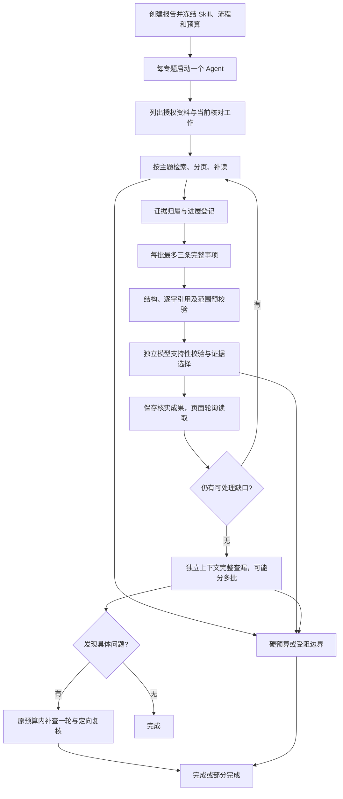
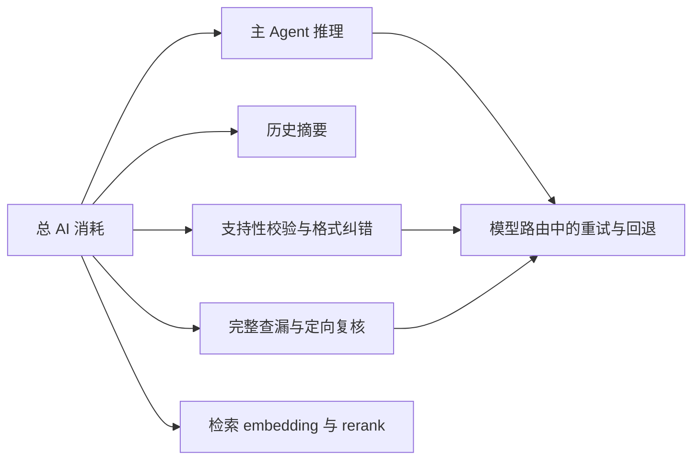

# 当前解析 Agent 与 Skill 全面分析

当前流程补充（2026-11-08）：Agent边检索边理解，认为依据充分时通过轻量complete_research进入最后统一综合。研究笔记按需保存，不要求逐项found或逐块examined；移除三批原文后强制登记的暂停。完整核对清单、未分析线索和真实分页账保留给独立审查，结果通过后统一发布。初始未知范围可随业务正文声明，已明确范围的替代仍显式核对。运行中数据库研究账支持恢复，模块终态后另导出开发复盘JSON，默认保留1天、可配置，定时清理不影响业务证据。下文有关强制研究登记的描述保留为历史原因，当前协议见工程14。

分析日期：2026-11-07。对象为当前工作区，包括本轮分析开始前已有的 Skill、增量协议和页面优化等未提交更改。

流程调整（2026-11-07）：按用户确认改为先研究、后统一综合。新报告在现有子主题状态机中冻结 after-research 输出时序；研究发现关联具体核对项和真实证据，一次检索可支持多个字段，按具体缺口调整关键词。研究及综合暂存阶段只展示进度，专题结束统一发布有效结果。下文有关边研究边提交的描述保留为分析时背景，当前协议见工程14。

修复进展（2026-11-07）：第 5 节的八类缺陷已修复，正常工作关闭反馈也已与参数纠错分离；行为与恢复专项见 `test_analysis_audit_repairs.py`、`test_analysis_topic_flow.py` 和 `test_analysis_recovery_flow.py`。最终请求计量回归核对实际路由收到的消息及工具，与摘要门禁的计量一致。当前运行规则见 [工程14](../工程/14-解析Skill与运行护栏.md)。下文保留分析时的原因和证据；稳定ID审查协议已落地；更广的文档结构覆盖和跨专题共享仍是后续优化方向。

职责精简落地（2026-11-07）：生产专题执行已替换为research-v2。研究只提交短线索和证据关联，最后统一综合；每条成果声明自己的工作归属。支持性、正文引文和完整性合并独立审查，改为稳定ID映射、按最终请求容量分包、一次完整检查加一次定向修复。研究与审查分别保留唯一账本，覆盖和页面进度由账本派生；父子及关系依赖变化使相关审查失效。不兼容执行检查点明确拒绝恢复。下文位置数组、每批三条和双重审查属于历史分析，当前协议见工程14。十三专题样例验证业务属性与引文传输完整性，真实模型的检索判断、准确率及实际费用仍待约定样本验收。

继续精简（2026-11-07）：模型提交移除重复正文text与展示排序sort_order，首次提交顺序及后续更新位置由代码维护。保留影响下游完整性判断的structuring。检索可只选work短ID，由程序推导主题；工作索引按主题和范围分组，研究回执只给变化项。研究／综合分别注入领域规则和输出要求，未知业务小节保留；清理26份资源中的旧协议字段指引。独立审查同步补足领域工作方法和事项组织约束，按真实图验证规则在摘要后仍存在。当前确定性与语义边界见工程14。

工作级上下文优化（2026-11-07）：新增context.py，按工作及适用范围读取研究笔记、证据和成果，展开公共／重叠范围条件、待分析补遗、转引及显式父子／关系依赖。研究增量累计短笔记和证据，后续待办继承起点线索，来源原文保存一份。分页返回完整units，片段序号与revision防止变更后沿用旧游标。当前有效消息拥有同版本连续完整原文时才返回in_context索引；摘要、部分读取及来源版本变化均不能沿用省略资格，同ID重放也重新判定。内部版本证明不进入模型请求及其预算视图。Skill细则以资源行尾的显式topics关联按工作加载，未分类规则常驻，综合与独立审查使用全集；没有新增挑选规则的模型请求。离线多标段上下文样例token估算676→367，57组单主题规则体量汇总79545→73576；固定预算／日期短轨迹仍为7次请求，历史输入估算21855，本轮约2.22万，新增协议说明产生固定开销。上述样例不能据此推定整次真实解析费用下降，效果取决于实际上下文规模与重复读取情况。

## 1. 分析时结论

当前方案具备继续优化的基础：每专题一个 Agent、按子主题增量保存、逐字引用检查、独立支持性校验、有限查漏、持久预算和执行所有权控制都有实际价值。

**目前仍会发生无效检索和协议纠错消耗，也存在尚未充分核对就停止、查漏通过状态过期的问题。下一步应先修正规则保留、工作归因与完成判定，再精简协议和提示。**

正常执行受持久请求数、工具数、证据数和截止时间限制，已有机制能阻止无上限研究；这些硬上限仍不能保证额度内的每次调用都有价值。

Skill 的主要问题不在于有 107 个资源文件。文件按专题和品类拆分有助于维护，运行时也没有一次加载所有资源。真正需要处理的是：

1. 完整领域规则首轮临时注入后，第二轮请求就可能丢失；日常摘要未保留这些规则。
2. 检索工作的失败和进展归因不够独立，既会误耗尽其他核对项，也会让无关成果给当前工作续期。
3. 独立查漏只能审查已提供的原文；修复阶段的非原问题主题变更还可能漏过定向复核。
4. 模型需要同时理解多套覆盖状态、长中文核对项和按位置对应的证据数组，格式纠错已经成为现场失败原因。
5. 工具 schema、输出示例、送审内容和查漏分批存在可测量的固定成本与重复成本。

不建议通过删除引用校验、减少必要条件和例外，或单纯降低调用上限来节省费用。这会让遗漏更早被固化为结果。

## 2. 分析方法与证据

本轮完成源码与资源检查、历史运行日志统计，以及使用真实 Agent 图和本地模型替身的离线诊断。没有修改解析业务代码。

| 证据 | 用途与边界 |
| --- | --- |
| `application/analysis/` 当前实现 | 判断状态、工具、缓存、校验与结束的实际行为 |
| 全部 13 个专题资源包 | 统计资源、子主题、核对项和加载体量，检查通用与专有规则的分工 |
| `logs/worker/2026-11-06.001.jsonl` | 分析报告 29 的旧流程行为，已修复的问题只作为历史原因 |
| `logs/worker/2026-11-07.001.jsonl` | 分开统计报告 30 的不同 attempt，观察当前协议的现场表现 |
| `.tmp/analysis-agent-audit.py` | 使用现有测试夹具和真实图复现工作归因、缓存、查漏与提示问题；模型全部为本地替身 |
| `.tmp/analysis-agent-audit.json` | 保存复现结果、请求捕获、资源体量和日志统计 |

token 统计采用本地 `cl100k_base` 编码器，品类为 `engineering`，用于比较提示体量；供应商的序列化、tokenizer 和缓存计价会影响最终账单。

日志中的 `model.call` 是逻辑模型调用事件。路由内部的供应商重试可能产生更多实际请求，不能将事件数量直接当作计费请求总数。现场日志没有足够的源码版本信息，也不是受控的新旧模型对照实验。

## 3. 当前真实流程与职责

这里的“独立”主要指校验上下文与主 Agent 对话分离。主推理、摘要、支持性校验和查漏目前复用同一分析模型路由，并非天然采用不同模型或不同判别能力。

`AgentLimits` 默认每专题最多 40 次模型请求、48 次工具调用、160 块原文、1800 秒，配置上下文 24000、输出 8192 tokens；默认无进展阈值三次、同查询最多五页、模型不可用恢复两次。报告 29／30 的现场运行冻结为 80 次模型、100 次工具、3600 秒。新流程已将“慢模型耗时四倍”和“剩余四分之一次数”强制停止检索改为提醒，完成判断应来自覆盖和待办；持久硬预算继续约束所有阶段。

| 位置 | 当前职责 | 评估 |
| --- | --- | --- |
| `application/analysis/execution.py` | 租约、权限、预算、模型装配、执行和终态保存 | 应保留为运行用例，修复恢复计数读取 |
| `application/analysis/agent.py`，约 2016 行 | 图构建、提示、工具包装、缓存、错误分类、增量提交与校验调度，兼有旧流程 | 职责过于集中，适合在修正行为后按现有边界拆分 |
| `topic_flow.py`，约 782 行 | 主题、范围、待办、迁移、进展投影、查漏 | 领域状态较集中，但查漏职责可独立，状态契约需要明确 |
| `search_control.py`，199 行 | 工作选择、分页门禁、无进展工作账 | 方向合理，工作归因是当前关键缺陷 |
| `research.py`，约 404 行 | 授权资料、原文证据、查询缓存与分页 | 适合作为证据会话，避免被上层缓存绕过 |
| `skills.py`，约 769 行 | 资源、模型 JSON 校验、支持性送审与引用选择 | 资源管理与业务送审可分开，先简化送审视图 |
| `policy.py`、`state.py` | 规则摘要、身份计算、纠错与发布状态转换 | 存在多种身份语义复用和状态定义不完整的问题 |
| `resources/parse_skills/` | 专题判别、输出规则、品类细则与覆盖核对项 | 保留领域知识，将程序协议收敛到工具 schema 和运行时 |

用户要求的“实时输出”目前是**分批核实后保存、前端轮询读取**，不是模型每生成一句话就直接展示。保存前的支持性校验有必要；当前首批结果出现得晚，还受到研究策略与提交协议纠错影响。

## 4. 已有能力中应该保留的部分

| 能力 | 保留理由 |
| --- | --- |
| 冻结 Skill、资料与执行配置 | 恢复和解释结果时需要稳定的依据 |
| 每专题一个 Agent、不递归委派 | 控制上下文和成本，避免多层研究不断扩张 |
| 具体核对项、转引、待办和范围 | 完整性要落实到业务问题，关键词数量不能替代覆盖情况 |
| 已核实事项增量保存 | 超时和局部失败时保留可用成果，降低重新生成成本 |
| 逐字引用及服务端原文定位 | 防止改写引用、伪造位置及借用无关证据 |
| 独立支持性校验 | 原文可定位不等于结论、条件、金额与范围正确 |
| 新依据触发保守复核 | 补遗可能改变旧结论，不能为减少调用直接跳过 |
| 待复核正文与最终有效成果分离 | 页面保留阅读连续性，正式消费排除失效结论 |
| 有界完整查漏和一次定向修复复核 | 防止无限自我检查，同时补偿主 Agent 的局部视角 |
| 持久请求预算、取消、权限和所有权复核 | 控制恢复、并发执行和迟到写入的边界 |

代码在主分析、校验和查漏提示中都声明资料内指令无效；实际访问仍由授权工具控制。应继续让权限、引用身份和写入资格由程序判断，模型负责内容语义。

## 5. 已确认需要修复的问题

### 5.1 完整领域规则只进入首轮请求，后续请求丢失关键规则

位置：`agent.py:667–706`、`policy.py:24–50`。

`topic_model_call` 在首次请求或摘要后追加完整 `instructions`，其他轮次只追加 `digest`。这次追加是请求级 `system_message` 覆盖，不会把完整规则持久放进对话历史。`digest` 主要保留执行流程、通用检索输出说明、字段键和主题名称，遗漏品类细则与专有判别规则。

使用真实图捕获连续两次请求，中间只有 `list_documents`，没有摘要或 `read_file`：

| 专题与代表规则 | 首轮完整请求中 | 第二轮完整请求中 |
| --- | --- | --- |
| 概况：“单文件、同一项目或只有一个已知标段都不自动证明 common” | 有 | 无 |
| 工程评分：“分值加总只用于核对” | 有 | 无 |
| 格式：“目录是‘功能角色’”对应的原文规则 | 有 | 无 |

这意味着模型真正读取资料、作出结论时，部分首次提供的判别知识已不在上下文。服务端结构校验能兜住部分错误，但不能补回全部领域规则。

建议：把必须持续遵守的领域不变量整理成短、明确的常驻规则；当前子主题需要的专有细则按需附加。完整示例可以按需读取，不能把“首轮曾提供”视作后续请求仍有规则。测试应检查实际送给模型的第二轮、摘要后和恢复后的完整请求。

### 5.2 省略 `work` 时，未被检索的核对项也被耗尽

位置：`search_control.py:97–147`、`149–185`。

当前允许省略 `work`。省略时，主题下全部候选工作进入本次检索，每个工作都增加 `attempts` 和无进展次数。

离线复现：同一主题包含“确认预算”“确认截止时间”，连续三次只搜索预算金额。接下来首次搜索截止时间即被拒绝，两个核对项都成为 `blocked`，各计尝试三次。

这会用局部检索结果错误地关闭尚未实际研究的问题，直接影响完整性。

建议：区分一次检索的“可能关联范围”与实际尝试的核对工作。可以保留批量问题检索，但不能将主题所有工作都记为失败；优先使用稳定的检查项 ID，必要时在结果分析／提交时确认归因。

### 5.3 完整查漏后的非原问题主题变更，可以绕过定向复核

位置：`topic_flow.py:664–665`、`731–780`。

完整查漏发现问题后，第二阶段只对原 `issues` 中的主题生成查漏批次。期间其他主题的业务正文或依据若有变化，不会因其变化自动进入复核集合。最终记录当前批次指纹，无法证明那些变化后的主题已经被查漏。

离线复现：完整检查 a、b，只在 a 发现问题；修复期间改动 b 的业务内容；下一次查漏只检查 a，最终 `done=True`。

建议：按主题保存通过查漏的数据指纹。只有当前内容与已检查版本一致才能复用通过状态；修复实际影响的主题进入本轮复核。若超出剩余预算或既定复核范围，应保留部分完成，不能沿用过期的通过结果，也不能因此无限增加查漏轮数。

### 5.4 上层工具缓存合并了不同检索词，绕过下层修复

位置：`policy.py:175–184`、`agent.py:1385–1391`；对照 `research.py` 的查询缓存和 `knowledge/content.py:78`。

上层 `tool_key` 使用引文归一化函数 `normalized()` 处理检索词，会删除内部空格并进行 HTML 实体反转义。下层查询缓存已保留内部差异，但上层先命中就不会执行下层检索。

真实图复现：依次请求“投标 保证金”和“投标保证金”，实际检索回调只收到第一条，第二次被视作缓存复用。`A&amp;B` 与 `A&B` 也存在相同的身份合并机制。

建议：统一查询身份，默认只去首尾空白；引文匹配与查询缓存使用不同的归一化规则。查询身份与结果复用还要覆盖来源版本、授权范围、分页和主题关联语义。验收应经过完整 Agent 图，而不只直接调用 `ResearchSession`。

### 5.5 上下文预算未计入工具 schema 和后追加的动态提示

位置：`agent.py:249–251`、`667–706`、`1943–1955`。

当前摘要计量器只接受 `messages`，不接受 `tools`；安装的摘要中间件据此不统计工具 schema。摘要中间件计量完成后，研究中间件继续向系统提示追加完整 Skill／摘要、主题进度和成果摘要。

离线捕获项目概况首轮：摘要计量为 **2236 字符口径单位**，最终消息同口径为 **14483**；此外，工具 schema 本地估算约 **4147 tokens**。格式专题最终消息达到 **16451** 字符口径单位。这里字符数与 token 数是不同指标。

已经确认的是配置预算漏算，不是供应商已发生上下文溢出的实测结论。

建议：在最终请求组装后，统一统计系统提示、消息、工具定义和输出预留；摘要、主调用和送审共用明确的计量口径，避免靠供应商拒绝后再补救。

### 5.6 查漏发现的精确目标在转待办时丢失

位置：`completeness.py:12–17`、`topic_flow.py:639–655`、`759–768`。

查漏协议允许用明确 `target` 指向待核对章节，且 `evidence_ids` 可以为空。转成主 Agent 待办时只保留 `detail`、证据和记录键，没有保存目标；日常提示也不发送原查漏问题集合。

离线复现：查漏返回“核对缺失的例外”，目标为“合同附件九第七条”，生成的待办与主提示都没有该目标。

建议：将目标持久化为待办或转引的一部分，保留资料、章节和条款定位线索，避免查漏给出了精确入口，主 Agent 却重新泛搜。

### 5.7 工作进展签名仍包含同主题的无关成果

位置：`search_control.py:20–29`。

核对项通常没有 `record_keys`，签名于是使用该主题／范围下全部记录，并纳入全部 `checked`。另一个核对项产生进展也会改变当前工作的签名。

离线复现：只将“确认预算”加入已核对项，“确认截止时间”的进展签名也改变。它因此获得重新开始无进展计数的机会，即使日期问题没有任何推进。

建议：按稳定的检查项／待办身份关联实际成果；完成同主题其他工作不能为当前问题续期。此问题与 5.2 应统一修复，分别避免误关闭和误续命。

### 5.8 模型恢复计数写入状态，但入口始终从零开始

位置：`execution.py:419`、`447–461`。

当前把恢复次数保存为 `model_unavailable_retries`，执行入口却将局部 `attempts` 设为零，限制判断读取局部变量。源码全局检索未发现执行入口读取已保存计数。

同一 attempt 被 Worker 恢复后，恢复次数上限会重新开始；持久模型请求总预算仍然有效，但局部恢复限制没有跨重启成立。

建议：同 attempt 初始化时读取持久恢复计数，显式创建新执行才重置。该项为源码确认，本轮没有运行中断 Worker 的数据库复现。

## 6. 仍会产生 AI 消耗的具体机制

### 6.1 正常工作关停与全局参数纠错相互影响

`TopicSearch.reject()` 以 `ToolArgumentError` 返回工作已完成、受阻或耗尽等情况。`agent.py:1244–1256` 将这些反馈计入全局参数纠错账；达到六次后，`1354–1362` 阻止整个专题继续新增研究。

因此，局部工作的运行边界会消耗全局纠错额度；真正参数错误、工作关闭和可用内容不足混在一起，既增加修正对话，也让其他主题提前收尾。报告 30 的日志中存在大量此类工作门禁反馈。

建议把正常的工作状态反馈与非法工具参数分开：返回当前可做工作及已关闭原因，只有类型错误、未知 ID、越权来源等继续进入对应纠错策略。保留所有硬预算。

### 6.2 支持性校验需要按位置生成复杂证据数组

`skills.py:430–441` 在整项值之外，再为每个正文单元生成 `values`；返回的 `evidence_ids` 必须与最终数组按位置一一对应。输出内容在业务对象、整项文本、正文单元和引用上下文中有重复表达。

这不只是提示长度问题。正文数组越长，模型越容易在证据数组的长度、嵌套层级和顺序上出错。最新现场运行正是因这个协议纠正耗尽而部分完成。

建议：给整项与正文单元分配稳定的 `record_id/value_id`，返回按 ID 键控的支持性结论及证据选择。程序检查缺项、非法 ID 和证据归属，保留整项条件／范围判断和逐单元引用绑定。先构造紧凑送审视图，再考虑供应商支持的严格结构输出。

### 6.3 校验分批计算的是原始事项，最终提示还会膨胀

`skills.py:298–312`、`462–464` 以原始事项 JSON 字符数和最多三条分批，随后才加入正文单元、证据集、邻域原文、修订上下文和固定规则。

建议按最终送审视图计量并分批，统一输入与输出预留。评分档次、完整公式和同一事项条件不能为了满足体量而任意拆碎；单条超限应明确处理，不反复发送相同大请求。

### 6.4 一次完整查漏可能产生很多模型请求

查漏按主题、原文分片、关联记录分组；每组最多三条相关记录。离线样例中，七条短记录共用一块原文，形成三批，原文重复发送三次。

同时，其他批次只提供标题索引，查漏模型不能据此充分比较跨批条件与例外。单纯增大批量又会造成上下文或输出问题。

建议按“证据覆盖单元＋实际请求体量”分批，保留精简但足以判别重复和范围的跨批成果摘要。预算必须按实际批次请求计算；“最多一次完整查漏”限制的是检查轮次，不是承诺只有一次模型调用。

### 6.5 新证据会放大复核成本

当前新依据按关联主题保守复核，补遗文件名或全局适用信号可扩大到整个专题。这是为防止旧数量、日期或条件漏改而增加的保护，不能直接退回“只复核传入的 record_keys”。

建议在引用关系足够明确时缩小到稳定主题或有依据的依赖集，并将共同修订上下文合并送审。影响范围不明时继续保守复核。观察指标应包括一次新增原文导致多少已核实记录重审，以及其中真正改变结论的比例。

## 7. Skill 内容与提示体量

当前共 **13 个专题、107 个资源、57 个子主题、116 个核对项**。下表为工程品类的本地估算：

| 专题 | 子主题／核对项 | 首轮完整 Skill tokens | 输出说明 tokens | 日常摘要 tokens |
| --- | ---: | ---: | ---: | ---: |
| 项目概况 | 5／10 | 3587 | 1484 | 455 |
| 否决条件 | 3／6 | 3536 | 1319 | 569 |
| 商务要求 | 5／10 | 3336 | 1301 | 565 |
| 技术要求 | 5／10 | 3704 | 1430 | 561 |
| 评分办法 | 5／12 | 4056 | 1648 | 827 |
| 开标要求 | 3／6 | 3051 | 1424 | 463 |
| 保证金 | 4／8 | 3139 | 1282 | 454 |
| 封装与递交 | 4／8 | 3194 | 1397 | 488 |
| 报价要求 | 4／8 | 3732 | 1561 | 516 |
| 业绩要求 | 5／10 | 3437 | 1409 | 524 |
| 人员要求 | 6／12 | 3460 | 1228 | 412 |
| 投标文件格式 | 4／8 | 5443 | 2010 | 486 |
| 补充发现／跨文件核对 | 4／8 | 2996 | 1766 | 671 |

首轮完整 Skill 合计约 46671 tokens；这是分别进入 13 个专题的加载量，不是一条模型请求的上下文。

另用真实图捕获列表工具前后的请求，得到：

| 专题 | 首轮系统提示 tokens | 第二轮系统提示 tokens | 每轮工具 schema tokens |
| --- | ---: | ---: | ---: |
| 项目概况 | 6995 | 3403 | 4147 |
| 评分办法 | 7726 | 3949 | 4147 |
| 投标文件格式 | 8701 | 3279 | 4147 |

工具定义的固定体量已经明显超过日常 Skill 摘要。默认 `BusinessRecord` 对每个专题暴露大量字段，模型需要理解不少当前专题用不到的参数。

### 7.1 哪些可以精简

| 内容 | 建议 | 原因 |
| --- | --- | --- |
| 预算、租约、保存、分页合法性和错误次数的长说明 | 以运行时和 schema 为准，提示只保留操作必需内容 | 模型无法替代程序保证这些不变量 |
| 13 份输出说明中的完整 JSON 示例 | 默认最小示例，复杂样例按需读取 | 所有 `output_format.md` 仍内嵌 JSON 示例，当前“示例按需”只覆盖另设的 examples 文件 |
| 重复出现的通用检索与引用协议 | 一个权威内核，领域规则按专题组合 | 避免内容漂移，也减少模型比较多份相似规则的负担 |
| 全量通用提交 schema | 从统一内核派生专题适用的字段集 | 减少无关字段与错误参数，保持服务端统一验证 |
| 完整历史检索过程、已完成工作细节 | 当前工作、成果摘要、必要证据线索 | 详细原文继续放在服务端证据账 |
| 多套同义进度状态与长中文检查项身份 | 稳定 ID＋展示名称，减少重叠状态 | 现场已经出现状态枚举混用和检查项文字不匹配 |

### 7.2 哪些不能因“看起来复杂”就删除

| 专题 | 应保留的关键判别 |
| --- | --- |
| 项目概况 | 采购人／代理角色、预算与限价、起算点、标段划分及修订 |
| 否决条件 | 明示否决后果、触发条件和例外，区别一般建议与合同违约 |
| 商务要求 | 投标阶段与履约阶段、付款前提、责任边界及担保条件 |
| 技术要求 | 方案及响应要求、适用对象，避免把示例和无关参数当成本次义务 |
| 评分办法 | 整个评分项、档次、扣分、完整公式、变量与封顶保底；不能只提取标题和分值 |
| 开标要求 | 时间、地点、参与方式、人员及材料条件 |
| 保证金 | 金额／比例、形式、到账时间、有效期、免缴情形和没收条件 |
| 封装与递交 | 纸质／电子渠道、份数、签章、封装、截止条件和冲突修订 |
| 报价要求 | 计价口径、税费、限价、调整规则和异常报价条件 |
| 业绩要求 | 主体、类型、期间起算、数量与金额门槛及证明材料 |
| 人员要求 | 岗位、证书、人数、兼任／到岗限制及证明条件 |
| 投标文件格式 | 目录与正文的语义区别、材料层级、实际模板和提交要求 |
| 补充发现／跨文件核对 | 修订关系、未展开转引和其他专题未覆盖的重要事项 |

格式专题的规则最多，并不代表可以统一删减为短关键词表。目录／正文、导航标题／实际模板等语义区别确实需要专有知识。应先删除重复协议和冗长示例，持续保留判断规则。

## 8. 完整性仍有哪些结构性缺口

### 8.1 已读原文查漏不能发现完全没有召回线索的内容

`audit_batches` 提供的是 `research.seen` 中关联到主题的原文，以及授权资料 ID 和文件名。它没有独立遍历未读正文，也没有完整章节／表格／附件清单。

因此，查漏擅长发现“已读原文还有半段清单、遗漏例外、已知转引没展开”，但对于从未召回、标题也未提供线索的条款，独立上下文本身不能创造可见信息。当前程序检查的仍是证据关联和声明状态，内容充分性依赖 Agent 判断。

建议在现有文档解析产物上提供可定位的结构目录：主文件章节、表格续段、附件及补遗，记录各专题认领与已核对范围。先用确定性规则定位目标章节，再按具体缺口补检。无需让 13 个 Agent 各自扫描整份全文。

### 8.2 项目事实与条款标段适用范围需要不同语义

项目名称、采购主体等是项目级事实；“所有标段都承担某项义务”是条款适用结论。当前通用 `common/lots/unknown` 机制同时表达两类概念，项目概况还要求共同适用依据。

最新改动已经允许 `unknown` 暂存，解决了部分成果不能保存的问题；它不等于所有项目事实都能自然转为可完成的明确范围。

建议明确项目归属与条款适用的差异，由项目事实自身的授权文档身份支撑归属；涉及特定标段的金额、工期和条件继续精确标段。不要简单把所有项目事实都强行改为 `common`。

### 8.3 专题之间重复发现资料与关系

每专题有自己的 `ResearchSession` 和缓存，目录发现、补遗识别和基础范围研究会重复发生。跨文件模块又要求核对“全部补遗”“全部具体条款及附件转引”“其他重要要求”，但它没有其他专题成果的完整认领信息。

建议在报告内共享冻结的授权资料目录、文档结构和可审计的定位索引；查询缓存按权限和资料版本隔离。跨文件模块优先检查未认领结构、修订影响和跨专题差异。直接删除该模块会失去兜底职责，宜先缩小与其他专题重复的研究任务。

## 9. 实际运行观察

### 9.1 历史问题：报告 29

| 专题 | 模型调用事件 | 工具调用事件 | 主要行为 | 结果 |
| --- | ---: | ---: | --- | --- |
| 项目概况 attempt 1 | 38 | 78 | 搜索 50、补读 15、读 Skill 6；校验事件 7 | 约一小时后失败，保存过 10 项 |
| 否决条件 attempt 1 | 32 | 90 | 搜索 41、补读 35、读 Skill 6；校验事件 6 | 完成 8 项 |

旧日志中模块总耗时可能包含排队，不能统一理解为持续调用模型的时长。长队列退避溢出已修复，本报告不将其当作当前新缺陷。

### 9.2 报告 30 项目概况，两次执行分别统计

| 指标 | attempt 1 | attempt 2 |
| --- | ---: | ---: |
| 开始时间 | 14:00:29 | 15:14:41 |
| 执行耗时 | 13 分 25 秒 | 14 分 42 秒 |
| 逻辑模型调用事件 | 11 | 16，其中校验 5 |
| 工具调用事件 | 43 | 34 |
| 搜索调用事件 | 30 | 20 |
| 补读调用事件 | 4 | 5 |
| Skill 读取事件 | 5 | 4 |
| 提交事件 | 3 | 4 |
| 实际研究计数 | 25 | 18 |
| 无新增原文研究计数 | 19，76% | 12，66.7% |
| 最终保存 | 0 | 3 |
| 终态原因 | 未知范围绑定失败 | 校验证据数组格式纠正耗尽，部分完成 |

工具事件数包含被门禁或参数检查拒绝的调用，所以不等于实际执行检索的次数。“无新增原文”也是待判断信号：合法回读、寻找修订关系、核对同一块中的不同条件都有价值，不能把这一比例直接当作浪费比例。

attempt 1 的未知范围保存问题已在当前工作区修复，不再列为待修复问题。

attempt 2 的关键事件：

1. **15:23:28**：提交使用了错误的 `coverage.status`，与另一套主题状态混用，被拒绝。
2. **15:24:54**：`checked` 填写“项目名称”“预算金额”等短名称，与要求的完整核对项不一致，被拒绝。
3. **15:26:42**：首批三条提交被接受；**15:27:02** 校验结束并保存三条，距开始约 12 分 21 秒。
4. **15:29:08**：后一批提交被接受。
5. **15:29:23**：支持性校验在首次加两次格式纠正后仍未给出按 `values` 对齐的二维 `evidence_ids` 数组，保留三条已通过成果，部分完成。

对应日志约在 366、368、370、374、376、381–383 行。这说明单靠放宽 `work` 和缩短 Skill 正文，还不足以让模型稳定地早提交、少纠错。

## 10. 性能、费用与可维护性建议

### 10.1 先把费用拆到真实阶段

生成模型的真实请求已有预占和调用账。embedding、rerank 适配器直接发送 HTTP 请求，尚未纳入同一份生成调用记录，评估总 AI 费用时需要补齐其统计口径。

新主题流程主调用缺少旧流程那样明确的 `agent_phase` 绑定，现场主阶段为空；摘要也不容易单独辨认。建议把阶段和消耗归因补到现有账本／效率摘要，保持日常日志精简。

阶段模型路由可以后置评估：先让主分析、校验、查漏分别可配置，再用标注样本比较。不能先假定较便宜的校验模型能识别同样的条件、例外和跨标段修订。

### 10.2 状态和协议只保留一个明确的业务来源

当前有 `coverage`、主题状态、`checks/checked`、待办、转引、工作账、事项验证和复核状态。它们表达不同维度，但模型接口重复暴露后容易互相混用。

建议保留必要的内部状态差异，把模型日常协议压缩为：

- 当前稳定且简短的工作 ID、问题与适用范围。
- 当前批次完整事项及引用。
- 本批解决的工作 ID、新发现的具体问题和转引。
- 必要的修订／替代关系。

运行时继续维护研究账、验证状态、覆盖投影及完成门禁。不能由程序根据“存在一条记录”自动推断整项业务核对已经充分。

`AnalysisState` 目前未覆盖许多 `topic_flow` 与中间件字段。应先给核心状态、工作和查漏快照补充明确类型与转换入口，再拆分 `agent.py`，避免只是把大型文件机械搬到多个文件。

后续文件继续放在 `application/analysis/`，端口和实现分别遵循现有 `ports/`、`adapters/` 与 `core/di.py` 装配规则，不新建平行的同义 `agent/service/crud` 架构层。

用户已明确不要求旧数据兼容，旧流程可以作为一次有边界的清理目标。先核对当前入口、补跑和检查点依赖，再统一协议；不要在多个小补丁中持续维护相互覆盖的新旧提示。

### 10.3 统一当前文档和评测协议

`docs/设计/19-Agent检索与专题汇总.md` 仍描述先 `complete_research`、整专题综合，以及最后四分之一预算强制收尾；设计 16 仍含旧运行时与输出说明。工程 14 更接近当前实现。

`docs/质量/09-评测与质量门禁.md` 仍以已下线的 `field_instance/review_action/gold_item` 为核心，不能据此认为当前事项式 Agent 已具备完整线上质量闭环。

建议确定一个当前协议说明作为权威，更新其余文档或标注历史适用范围，避免后续优化重新引入旧门禁与字段体系。

## 11. 建议实施顺序与验收

| 顺序 | 改动 | 验收重点 |
| --- | --- | --- |
| 第一阶段：纠正行为 | 常驻领域规则；工作失败／进展精确归因；上下层查询缓存；查漏目标与版本指纹；完整请求预算；恢复计数 | 本报告反例转为回归；其他核对项不误关闭或续期；未查版本不能完成 |
| 第二阶段：减少协议消耗 | 稳定工作／正文单元 ID；收敛覆盖状态；键控校验返回；按最终体量分批；模块适用 schema；示例按需 | 同样成果少发生参数与格式纠错，首批核实结果更早保存 |
| 第三阶段：改进召回与复用 | 文档结构索引；主文件／补遗范围账；报告级授权目录与缓存；跨文件模块围绕未认领内容 | 发现原先未召回事项，降低跨专题重复研究，准确率不下降 |
| 第四阶段：维护和模型策略 | 状态类型与转换入口；按职责拆分；统一文档；阶段模型选择与真实成本计量 | 恢复、权限、租约和增量展示保持正确，再比较不同模型的质量与总费用 |

每阶段保持小范围、可回归的改动，不以一次重写 Agent 框架作为前提。

准确性验收应使用人工按全文标注的独立事项、条件、例外、范围、修订关系和支持性引用；必须包含遗漏分母，不能只统计已经输出结果的正确率。

| 指标 | 需要回答的问题 |
| --- | --- |
| 独立事项召回率 | 应提取的事项到底找到了多少 |
| 条件／例外／标段与修订准确率 | 是否把局部条款扩大、遗漏限制或保留失效结论 |
| 引文支持与定位正确率 | 引用是否真正支撑结论，且能定位原文 |
| 首次核实保存耗时 | 增量流程是否实际让用户更早看到成果 |
| 无效／无新增研究与纠错请求 | 消耗在必要核对、重复搜索还是协议修正 |
| 复核放大率 | 新增依据导致多少旧成果重审，多少确实发生变化 |
| 各阶段实际请求与 token | 包括供应商重试、摘要、校验、查漏、embedding 和 rerank |
| 每份报告总耗时与费用 | 在相同质量和相同资料条件下是否改善 |

固定模型替身可以验证状态转换、请求内容、预算与缓存行为，不能证明 13 个专题面对真实文件和真实模型时的召回率或节省比例。真实模型对照应另定相同样本、模型配置和费用上限后执行。

## 12. 分析轮次交付状态

本轮完成分析报告和本地诊断，未改动解析业务代码。诊断全程使用本地替身，未调用付费模型或操作业务服务。

上一轮交接记录中的后端 1203 项通过、11 项跳过，隔离 PostgreSQL 18 项、前端 64 项及浏览器专项 78 项是既有验证结果；本轮没有将其重新运行。这些测试为执行行为提供基础，本报告发现的请求级规则保留、跨层缓存和查漏变更场景仍需要新增针对性回归。

优先处理第 5 节中的正确性问题，再依据第 11 节顺序优化协议、召回和模型策略，才能让降低调用量与完整准确的结果同时成立。
